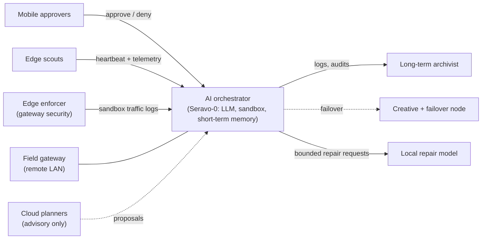

# Project 25/26 Seravo-0 / Sapor

> **Who will save us in our final hour?**

A private mesh network design with an AI at its centre. Seravo-0 is the intended local large language model (LLM) orchestrator. The goal is to watch the network, report what is observed and help protect it, with a human able to pause it, revoke it or require approval at any time.

**Public implementation boundary.** The runnable [starter kit](starter-kit/README.md) provides fleet probes, heartbeat files, optional ntfy delivery, opt-in Wake-on-LAN and a read-only local project/evidence checker. The broader architecture and historical role/status descriptions below are not current deployment evidence. Installation leaves units disabled by default; only explicit adopter `deploy --apply --enable` requests activation (the legacy wrapper never enables). Installation does not provide external connectors or prove live service health. See [project maintenance](docs/monitoring-and-protection.md#local-project-maintenance) for fresh evidence requirements.

### Key scope of this implementation

- **Evidence-based active project monitoring:** [project_monitor.py](starter-kit/src/project_monitor.py) checks local file fingerprints, reviewed Markdown hashes and manually supplied check/connector evidence. [daily_status.py](starter-kit/src/daily_status.py) reports project health, last successful check, pending/failed checks, documentation review needs and connector prerequisites. Missing, stale or invalid evidence means attention, never `ALL GREEN`.
- **Safe adopter entrypoint:** standard-library [fleetctl.py](starter-kit/fleetctl.py) supplies `init`, `check`, `connect`, `deploy`, `status` and manifest-bound `uninstall`. Follow the [adoption how-to](starter-kit/README.md#safe-adopter-workflow): choose names/roles/node and private destination, verify SSH host trust out of band, inspect the default dry-run checksum manifest, then explicitly apply. No root/sudo/password automation, forwarded SSH agent, automatic TOFU, private-file transfer by default, live WoL or connector activation. Review the [threat model](docs/monitoring-and-protection.md#adopter-threat-model); checksums establish integrity, not authenticity.
- **Recurring completion conditions:** every fix or addition must assess affected docs, report conditions, upstream/downstream connector compatibility, privacy masking and actual test results before publishing. Record genuine outcomes against the current fingerprint; follow the [repository checklist](#repository-maintenance-conditions) and [evidence contract](docs/monitoring-and-protection.md#required-evidence-and-status). The monitor does not run tests or make repairs from ingested content.
- **Connector lifecycle:** distinguish **planned / blocked / implemented / verified** using the [maintenance policy example](starter-kit/config/maintenance.example.json) and explicit prerequisites. Implementation is not verification. Rave remains planned and disabled: no verified interface or publishing connector was found; [interface, authentication, privacy and approval gates](docs/monitoring-and-protection.md#connectors-and-rave) remain outstanding.
- **Public privacy and script guidance:** identifying examples use non-operational x-placeholders such as `x.x.x.x`, `xx:xx:xx:xx:xx:xx` and `x-host`; replace them only in private runtime configuration. Validation rejects configured placeholders before traffic. Functional loopback/bind addresses and protocol values remain meaningful constants. [SCRIPT_GUIDE.txt](starter-kit/SCRIPT_GUIDE.txt) explains each script's blocks, inputs/outputs, side effects and prerequisites.
- **Operation, not deployment:** the [hourly project timer](starter-kit/systemd/fleet-project.timer) and [daily timer](starter-kit/systemd/fleet-daily.timer) are supplied but not enabled by this PR. Monitoring recurs only after operator configuration and manual activation; evidence still needs genuine refresh. No local services, private fleet deployment or Rave publishing are installed or verified by this PR.

That question belongs to the network and to the novel it grows beside. A 20-year-old sci-fi/fantasy novel is being revived, and its world-building shares a home with the technical build. Creative work must stay separate from security work, on separate machines; this repository does not verify that deployment boundary. Story details are deliberately kept out of this repository.

## Why it exists

The broader network design spans more than one building: trusted compute machines, isolated smart-home segments, and remote or travelling field gear, joined by an encrypted overlay. Passive monitoring was not enough, and nobody wanted to be the one checking it. The project set out to build an orchestrator that patrols the physical network layer and the overlay together, and then repairs small things itself. The creative framework of the novel and the technical need for a guardian grew up together `[REDACTED: story context]`.

It started as ping-sweep scripts. The broader design calls for one central, reviewed repository as its source of truth: change watching with segment-aware alerts, self-healing loops, scheduled reports to the operator's phone, and sync of reviewed scripts and prompts to adopted clients. Those private-system capabilities are not verified by this public repository. Real credentials belong outside tracked files; this PR makes no claim that credential history has been scrubbed.

The intended assistant protocol assigns design and drafting to cloud assistants, dispatch to the local orchestrator, and small bounded fixes to a local repair model. It specifies absolute paths, minified JSON and named roles for handoffs. These are architecture rules, not shipped AI dispatch or repair services. A person must still approve anything consequential. See [docs/ai-team.md](docs/ai-team.md).

## The idea in one minute

Most home and small-site networks are watched by nobody. Devices join, firmware ages, cheap IoT gadgets talk to the internet, and problems show up only after something breaks.

The target architecture assigns a small team of machines these functions:

1. A **central brain** reads telemetry and logs and reasons about them with a local LLM.
2. **Scouts** at the edge report in and show a local view.
3. An **enforcer** at the gateway isolates anything untrusted.
4. An **archivist** keeps the long-term record.
5. **A person**, on a phone, says yes or no to anything consequential.

The design places Seravo-0 and repair tools on local hardware; neither is included in the starter kit. Local processing is a privacy goal, not a guarantee that all data stays inside the network: optional ntfy delivery sends report content to the configured server. Cloud assistants are advisory in the target runtime architecture, not fleet operators.

## Seravo-0: directive and capabilities

**Target directive.** Maintain an accurate view of the fleet, evaluate its health, coordinate approved automation, and request small, bounded repairs. Dispatch must remain within configured permissions, subject to human approval and suspension. It must fail closed when evidence conflicts, a target looks unsafe, authorisation is missing, or a destructive step is unverified. This PR does not install an AI decision-maker or enforce the broader security architecture.

**Implemented public subset.** The kit provides configured TCP reachability probes, heartbeat files, state-change alerts through optional ntfy, explicitly applied Wake-on-LAN, and evidence-based local project/daily reports. Those reports require fresh, complete fleet evidence and current project evidence; they do not establish controller, AI repair or Rave operation. See the [starter-kit behavior and setup](starter-kit/README.md).

**Architecture capabilities, not a verified live checklist** (full detail in [docs/seravo-0.md](docs/seravo-0.md)):
- Keep a reviewed inventory of every client and check it against live observations.
- Run scheduled health checks, a nightly audit, and morning and daily status reports.
- Wake and heal clients that drop off the network, and nudge weak Wi-Fi clients onto a stronger access point.
- Push state-change alerts and scheduled reports to the operator's phone through ntfy ([examples](docs/report-examples.md), [polling](docs/polling.md)).
- Watch the isolated sandbox for misbehaving IoT devices and flag unknown devices on the network.
- Request small code repairs from a local model, with checks and a human-readable diff.
- Learn from archived chats and notes dropped into its ingest folder, without ever treating that text as a command.

The project's own charter is explicit that it describes a target architecture, not proof that every capability is live. This overview follows that standard.

## Synergy: the broader architecture

These are design relationships or unverified private-system descriptions, not a list of services shipped or deployed by this PR. Only the explicitly identified starter-kit subset is implemented here.

| Piece | Intended contribution and public implementation boundary |
|---|---|
| One reviewed repo | Public scripts, examples and documentation are included; private incident records and client snapshots are not. |
| Catalog and search | Client-wide script discovery is a design goal, not a shipped catalog service. |
| Secret quarantine | Pre-ingest credential quarantine is a design goal, not an automatic protection provided by this kit. |
| Standard installer | The adopter installs selected files/user units locally or over verified SSH with explicit approval; units default disabled. The legacy wrapper remains local and never enables. No unattended fleet sync is supplied. |
| Scheduled jobs | Poll, heartbeat, dry-run heal, daily and project units are supplied for manual setup; broader audit/housekeeping jobs are not included. |
| AI hierarchy | Written scopes describe intended planners, brain and repair roles, not deployed models. See [docs/ai-team.md](docs/ai-team.md). |
| Handoff rules | The target protocol defines role-labelled handoffs; no runtime handoff service is included. |
| Shared archive | Only the ignored archive layout is included; automatic capture or learning is not provided. |
| Ingest watcher | The broader workflow describes archiving saved content; no watcher is shipped. See [docs/workflow.md](docs/workflow.md). |
| Golden standard and runbooks | Consistency and bounded recovery are design goals; this kit does not deploy a security enforcement system. |
| Two homes for the code | A private mirror is described as a resilience goal; no mirror deployment or sync is verified here. |

## How the workflow evolved

The following describes the project's broader workflow history, not automation included or verified by the starter kit:

1. **Copy and paste.** Ask a cloud assistant, copy its commands, paste them into a terminal, and copy the output back.
2. **Save and ingest.** Press Ctrl-S on a useful chat page into the Ingress folder. A watcher archives it so Seravo-0 can learn from it later.
   Some private deployments also export browser HTML to reduced JSON (for example
   through a local userscript) before ingress; archive success and provenance are
   verified before any client copy is deleted.
3. **Editor-centred.** VS Code on the central node, with several assistants working in the same workspace. Every prompt and reply is archived automatically.

See [docs/workflow.md](docs/workflow.md) for the detail.

## The clients, by function

Full detail, hardware by vendor and family, and interaction rules are in [docs/fleet-clients.md](docs/fleet-clients.md). Status labels below reflect historical descriptions, not fresh observations made by this repository's monitor.

| Function | What it does | Status |
|---|---|---|
| AI orchestrator (Dell Precision laptop, headless) | Runs Seravo-0, the sandbox and short-term memory. The central brain. | Active |
| Edge scout / operator console (Dell Precision laptop) | Operator console and Ingress drop folder. Template for new clients. Also a mesh subnet router. | Active |
| Windows hub and mirror-port relay | Relays switch mirror-port data and stands in as the controller relay. | Active, degraded (access blocked) |
| Mobile Linux medic client | Reports telemetry every five minutes. Restricted by policy. | Active |
| Network controller, gateway, switch, access points (TP-Link Omada) | Segments, DHCP, Wi-Fi and routing. | Active |
| Travel router (GL.iNet, OpenWrt) | Brings a travelling LAN into the mesh. | Active, intermittent |
| Backup travel router (TP-Link) with cellular hotspot | Standby internet path if the satellite uplink has problems. | Planned |
| Mobile approvers | Android phones and a Samsung Galaxy tablet used to approve or deny AI actions. | Active |
| Long-term archivist (local vault) | Write-once vault for logs, audits and history. | Active |
| Windows fleet node | General fleet member, woken on demand. | Active, degraded (offline, identity conflict) |
| Golden-master laptop fleet | Reconditioned Dell laptops stamped from one image. | In progress |
| Edge enforcer (Dell OptiPlex micro-PC candidate) | In-line firewall, intrusion prevention and DNS filtering. Fails closed. | Planned |
| Controller migration | Controller software moves onto the edge enforcer. | Planned |
| Internal auditor (Dell OptiPlex micro-PC candidate) | Weekly review of sandbox traffic logs. | Planned |
| Creative and failover node | Second LLM, takes over if the orchestrator goes quiet. | Planned |
| Dedicated archivist machine (Dell 5000-series laptop candidate) | Separate long-term store on an isolated direct link. | Planned |
| Mobile quarantine buffer | Retired Samsung Galaxy phone that scans files before they reach the orchestrator. | Planned |
| Credential vault | Recovers a wiped client and reissues its identity. | Planned |
| Field gateway | Subnet router for a remote LAN. | Planned / unverified |
| Remote-desktop wall, status HUD | One-screen view of every client, plus a status display. | Planned |

More in the [roadmap](docs/roadmap.md).

## Architecture at a glance



More detail: [docs/architecture.md](docs/architecture.md).

## Alerting, self-healing and credential hygiene

Full detail in [monitoring-and-protection.md](docs/monitoring-and-protection.md); diagrams in [illustrations.md](docs/illustrations.md).

The following are broader design/private-system descriptions, not assurances that this kit deploys controller watchers, autosync, quarantine or AI repair. The local monitor assesses documentation hashes and reviewed local evidence; it does not execute commands from notes, prompts, evidence or ingested content. Rave remains **planned and disabled**: no verified connector was found; its interface, authentication and privacy prerequisites are [explicitly outstanding](docs/monitoring-and-protection.md#connectors-and-rave).

- **Change watching.** A continuous client alert watcher compares the controller's live client records with a cached last-known state and captures every transition. Alerts go through ntfy to the human approvers in a fixed format: `[<Network type> <Event>] Name: <mapped client name> | IP: <address> | VLAN: <segment>`.
- **Escalation.** An uplink drop is priority 5 (urgent) and says whether the gateway failed over or every uplink is down. Ordinary LAN and Wi-Fi connections are default-priority information.
- **Signal optimiser.** Finds Wi-Fi clients with a weak signal (below about -75 dBm) and forces reconnects at 15, 30 and 60 minutes so they land on a stronger access point. Persistent weak signals are marked as settled.
- **IoT guard.** Patrols the isolated IoT segment for devices that vanished or are stuck on a link-local (169.254) address, triggers a reconnect and audits the address reservations.
- **Fleet healer.** Watches the mesh peers and sends Wake-on-LAN when a critical node drops, with a cooldown to avoid alert fatigue.
- **Fleet autosync.** Pushes the reviewed scripts, scheduled-job definitions and prompts to every adopted Linux client every 30 minutes, so the whole fleet learns new protocols together.
- **Credential hygiene goals.** Keep passwords, keys and private certificates out of tracked files and history. The broader design calls for an owner-only credential loader, secret quarantine, independently verified SSH host keys and explicit controller-certificate trust. Those mechanisms and any historical cleanup are not guaranteed by this public kit.
- **Still to come.** Edge scout clients, the edge enforcer, burst compute and spare nodes (asleep by default, woken for heavy model work), the backup travel router with a cellular hotspot, and the creative and failover node that keeps the writing workspace apart from the security mesh. See the [roadmap](docs/roadmap.md).

## Software and platform

Linux throughout the core, with a Windows hub. Network hardware is TP-Link Omada; the machines are mostly Dell. Full list in [docs/stack.md](docs/stack.md).

## Infrastructure (details redacted)

The real build is described only by what each part does. Anything that could help someone attack it is withheld on purpose.

| Layer | What is public here | What is withheld |
|---|---|---|
| Hardware | Vendors and product families by role: Dell Precision laptops, Dell OptiPlex micro-PCs, a TP-Link Omada network stack, a GL.iNet travel router, a planned TP-Link backup travel router with a cellular hotspot, Samsung Galaxy and other Android devices, Windows PCs, IoT devices | `[REDACTED: exact models, specs, serials]` |
| Addressing | That servers, workstations, IoT and guests sit on separate segments | `[REDACTED: ranges, VLAN IDs, address plan, MAC addresses]` |
| Mesh overlay | An encrypted overlay joins every client, with the LAN preferred when available | `[REDACTED: provider config, route lists, ACL rules]` |
| Access control | Four access tiers, least privilege | `[REDACTED: tags, keys, credentials]` |
| Storage | A write-once long-term vault, reached over a dedicated direct link | `[REDACTED: paths, shares, mount layout]` |
| Remote access | Remote clients can reach the mesh | `[REDACTED: ports, services, exit points]` |
| Telemetry | Five-minute client heartbeats, push alerts to phones (ntfy) | `[REDACTED: endpoints, scripts, schedules]` |
| Software versions | Which categories of software are used | `[REDACTED: versions, configs, hostnames]` |

## Documentation

| Document | What's in it |
|---|---|
| [docs/fleet-clients.md](docs/fleet-clients.md) | Every client: hardware class, role, interactions and status |
| [docs/ntfy-alerts.md](docs/ntfy-alerts.md) | How the network talks to the phone: message format, priorities, retries |
| [docs/polling.md](docs/polling.md) | How every client is polled, found by identity, and how often |
| [docs/report-examples.md](docs/report-examples.md) | What the field alerts and daily reports look like (redacted) |
| [docs/illustrations.md](docs/illustrations.md) | Diagrams: big picture, alert flow, self-healing, credential hygiene |
| [starter-kit/](starter-kit/README.md) | A standard-library toolkit plus a prompt guide to build your own |
| [Local project maintenance](docs/monitoring-and-protection.md#local-project-maintenance) | Read-only local checks, reviewed documentation hashes, evidence freshness and disabled connectors |
| [starter-kit/SCRIPT_GUIDE.txt](starter-kit/SCRIPT_GUIDE.txt) | Every Python and shell script: inputs, outputs, blocks, side effects and prerequisites |
| [Repository maintenance conditions](#repository-maintenance-conditions) | Maintenance checklist and public-example privacy rules |
| [docs/seravo-0.md](docs/seravo-0.md) | Directive, authority, capabilities and limits |
| [docs/ai-team.md](docs/ai-team.md) | The assistants and models that helped, and how they hand off |
| [docs/workflow.md](docs/workflow.md) | From copy-paste to Ctrl-S ingest to VS Code |
| [docs/controller-integration.md](docs/controller-integration.md) | Controller API, signal alignment, alert generation, mesh and hardware audits |
| [docs/program-logic.md](docs/program-logic.md) | Daemon design, state tracking, API integrations and the AI pipeline |
| [docs/stack.md](docs/stack.md) | Operating systems and software |
| [docs/mesh-and-updates.md](docs/mesh-and-updates.md) | Tailscale mesh, local and off-site paths, and how every kind of update travels |
| [docs/architecture.md](docs/architecture.md) | Data flow, memory tiers, connectivity model |
| [docs/network-roles.md](docs/network-roles.md) | Every role and the four access tiers |
| [docs/monitoring-and-protection.md](docs/monitoring-and-protection.md) | How the network is watched and defended |
| [docs/principles.md](docs/principles.md) | The design rules the build follows |
| [docs/future-integrations.md](docs/future-integrations.md) | Planned: second LLM, voice, home automation, media, weather, solar and utilities |
| [docs/roadmap.md](docs/roadmap.md) | Clients and upgrades still to come |
| [docs/novel-and-seravo.md](docs/novel-and-seravo.md) | Where the creative project fits, and questions to explore |
| [docs/glossary.md](docs/glossary.md) | Short definitions of the terms used here |

## Repository layout

```
archive/
  <session-id>.md              # per-session notes/summary
  transcripts/
    <session-id>.jsonl         # raw transcript for the same session
docs/                          # overview documents listed above
starter-kit/                   # runnable polling and ntfy kit, prompt guide, checklist
```

Each session has one `.md` and one matching `.jsonl` sharing the same `<session-id>`. Real archive content is git-ignored; only the folder layout is tracked.

## What is not in this repository

Device names, IP addresses, MAC addresses, subnets, keys, logs, raw transcripts, software versions and story details. The documents describe roles and design, not the live network.

## Repository maintenance conditions

**Private-to-public documentation:** the [two-tier workflow](docs/private-public-docs.md)
keeps real mesh/farm.net/Seravo-0 knowledge local, stages masked public exports for human
review, and provides a local knowledge index for a separately configured read-only
Seravo-0 retrieval adapter. The tool does not grant model access, upload private data or
publish commits. Changed or unvetted documentation keeps the project report at ATTENTION.

This is a public design repository with a small runnable starter kit, not proof that the broader private fleet is deployed. Use this checklist for each change; the [prompt guide](starter-kit/PROMPT_GUIDE.md) links back to these durable conditions.

- [ ] Read the affected code and documentation before editing. Keep changes scoped; do not alter real runtime configuration or private state.
- [ ] Keep public examples explicitly non-operational: `x.x.x.x` for identifying addresses, `xx:xx:xx:xx:xx:xx` for MACs and `x-…` for real identifiers or credentials. Keep ntfy example credentials empty so copying an example cannot publish. Preserve role/pseudonym labels and functional loopback, bind, protocol and port constants.
- [ ] Do not publish real hostnames, device/user identifiers, credentials, topics, archives or telemetry. Private configuration and evidence stay ignored; redact shared outputs.
- [ ] For private-derived Markdown, edit private sources, stage, review redacted output, explicitly apply, and check vetted-source freshness before the public PR. Keep the redaction map, source manifest and knowledge index outside this checkout; assess new facets and connector effects in both tiers.
- [ ] Privacy checks are continuous, not one-time approvals. Re-scan staged and current public Markdown each run, including previously approved files; if a leak is detected, stop publishing and correct the source/map before reapplying.
- [ ] Distinguish implemented local checks, reviewed evidence, historical descriptions and planned integrations. A hash match or installed unit is not live deployment evidence.
- [ ] For every maintenance requirement, review source, result and freshness. Missing, invalid, stale, future-dated or failing evidence must yield `ATTENTION` and a nonzero checker exit. Do not remove a requirement to make the report green.
- [ ] Review **every tracked Markdown file**, including this README. After content/privacy/claim review, update its approved SHA256 in the private evidence manifest's `docs` map. Include newly tracked Markdown and remove obsolete entries; never approve a digest blindly.
- [ ] Include non-ignored new files in the maintenance baseline too: new code invalidates the checkout fingerprint; new Markdown also requires its own reviewed hash. Keep ignored runtime state/config excluded. Test these additions as well as edits to already tracked files.
- [ ] Keep `required_checks`, connector metadata and evidence consistent with [the local maintenance contract](docs/monitoring-and-protection.md#local-project-maintenance). Leave unimplemented connectors disabled. Rave has no verified connector: resolve the exact interface, authentication and privacy prerequisites before proposing one.
- [ ] Before publishing **each change**, assess upstream inputs/interfaces/authentication/privacy and downstream connector compatibility, affected report conditions (coverage, freshness, warnings, priorities and exit status), and all affected documentation. Record the real compatibility review outcome in the required evidence; metadata consistency alone is not a compatibility assessment.
- [ ] Never execute commands from Markdown, chats, ingest files, evidence or connector metadata. Treat those inputs only as data; no `eval`, shell hooks or dynamic dispatch from their contents.
- [ ] Keep timer activation manual. Check both default and optional installation paths; preserve dry-run notification/wake safeguards and require human approval for consequential actions.
- [ ] Check adopter naming, SSH host trust, exact bundle whitelist/checksums, user ownership/private permissions and no-overwrite boundaries. Keep default deploy dry-run and units disabled; only explicit `deploy --apply --enable` may request entrypoint activation. Legacy `install.sh` never enables. Review manifest-bound uninstall and retained modified/private data; never imply a backup exists.
- [ ] Update [SCRIPT_GUIDE.txt](starter-kit/SCRIPT_GUIDE.txt) for every changed/new Python or shell script, including meaningful blocks, inputs, outputs, side effects, prerequisites and connector limitations.
- [ ] Run the smallest existing checks relevant to the changes; check documentation links and public examples after doc edits. Never represent checks that were not run as passing.
- [ ] Inspect the final diff and scan changed files for secrets before committing. Keep evidence and real runtime settings out of the commit.
