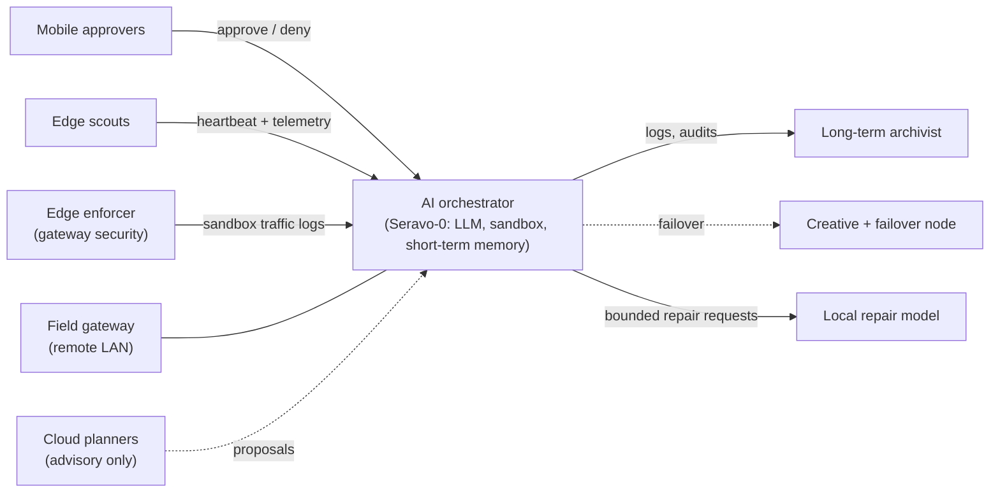

# Project 25/26 Seravo-0 / Sapor

> **Who will save us in our final hour?**

A private mesh network with an AI at its centre. Seravo-0 is a large language model (LLM) built into the clients of the network. It watches the network around the clock, reports what it sees, and helps protect it. A human can pause it, revoke it, or require approval at any time.

That question belongs to the network and to the novel it grows beside. A 20-year-old sci-fi/fantasy novel is being revived, and its world-building shares a home with the technical build. The two run on separate machines, so the creative work never touches the security work. Story details are deliberately kept out of this repository.

## The idea in one minute

Most home and small-site networks are watched by nobody. Devices join, firmware ages, cheap IoT gadgets talk to the internet, and problems show up only after something breaks.

This project puts a small team of machines on the job, each known here by its function:

1. A **central brain** reads telemetry and logs and reasons about them with a local LLM.
2. **Scouts** at the edge report in and show a local view.
3. An **enforcer** at the gateway isolates anything untrusted.
4. An **archivist** keeps the long-term record.
5. **A person**, on a phone, says yes or no to anything consequential.

Seravo-0 and its repair tools run on the network's own hardware, so network data stays inside it. Cloud assistants help with planning and design, but they only advise and never run operations.

## Seravo-0: directive and capabilities

**Directive.** Maintain an accurate view of the fleet, evaluate its health, coordinate approved automation, and request small, bounded repairs. Inside its configured permissions it is the final authority on what runs and when, and a human owner can suspend it at any time. It must fail closed when evidence conflicts, a target looks unsafe, authorisation is missing, or a destructive step is unverified.

**What it can do to date** (full detail in [docs/seravo-0.md](docs/seravo-0.md)):
- Keep a reviewed inventory of every client and check it against live observations.
- Run scheduled health checks, a nightly audit, and morning and daily status reports.
- Wake and heal clients that drop off the network.
- Watch the isolated sandbox for misbehaving IoT devices and flag unknown devices on the network.
- Request small code repairs from a local model, with checks and a human-readable diff.
- Learn from archived chats and notes dropped into its ingest folder, without ever treating that text as a command.

The project's own charter is explicit that it describes a target architecture, not proof that every capability is live. This overview follows that standard.

## Synergy: what was built to make it work together

| Piece | What it gives the project |
|---|---|
| One repo for everything | Scripts, prompts, standards, incident records and client snapshots live in a single searchable repository. |
| Catalog and search | Any client can find a script by name or purpose, even after it has moved. |
| Secret quarantine | Anything that looks like a credential is stopped before it reaches the repo. |
| Standard installer | A fresh client can join and sync itself with one command. |
| Scheduled jobs | About twenty timed jobs handle reporting, auditing, healing and housekeeping. |
| AI hierarchy | Planners, the central brain, and repair hands each have a written scope. See [docs/ai-team.md](docs/ai-team.md). |
| Handoff rules | Agents exchange work in one agreed format and name themselves in every log entry. |
| Shared archive | Every prompt and reply is saved so Seravo-0 can learn from past work. |
| Ingest watcher | A folder that archives whatever is saved into it. See [docs/workflow.md](docs/workflow.md). |
| Golden standard and runbooks | One set of rules, a self-healing runbook and a mesh-security runbook keep clients consistent. |
| Two homes for the code | A private GitHub repo plus a mirror on the network, so a client can sync either way. |

## How the workflow evolved

1. **Copy and paste.** Ask a cloud assistant, copy its commands, paste them into a terminal, and copy the output back.
2. **Save and ingest.** Press Ctrl-S on a useful chat page into the Ingress folder. A watcher archives it so Seravo-0 can learn from it later.
3. **Editor-centred.** VS Code on the central node, with several assistants working in the same workspace. Every prompt and reply is archived automatically.

See [docs/workflow.md](docs/workflow.md) for the detail.

## The clients, by function

Full detail, hardware by vendor and family, and interaction rules are in [docs/fleet-clients.md](docs/fleet-clients.md).

| Function | What it does | Status |
|---|---|---|
| AI orchestrator (Dell Precision laptop, headless) | Runs Seravo-0, the sandbox and short-term memory. The central brain. | Active |
| Edge scout / operator console (Dell Precision laptop) | Operator console and Ingress drop folder. Template for new clients. Also a mesh subnet router. | Active |
| Windows hub and mirror-port relay | Relays switch mirror-port data and stands in as the controller relay. | Active, degraded (access blocked) |
| Mobile Linux medic client | Reports telemetry every five minutes. Restricted by policy. | Active |
| Network controller, gateway, switch, access points (TP-Link Omada) | Segments, DHCP, Wi-Fi and routing. | Active |
| Travel router (GL.iNet, OpenWrt) | Brings a travelling LAN into the mesh. | Active, intermittent |
| Mobile approvers | Android phones and a Samsung Galaxy tablet used to approve or deny AI actions. | Active |
| Long-term archivist (local vault) | Write-once vault for logs, audits and history. | Active |
| Windows fleet node | General fleet member, woken on demand. | Active, degraded (offline, identity conflict) |
| Golden-master laptop fleet | Reconditioned Dell laptops stamped from one image. | In progress |
| Edge enforcer (Dell OptiPlex micro-PC candidate) | In-line firewall, intrusion prevention and DNS filtering. Fails closed. | Planned |
| Controller migration | Controller software moves onto the edge enforcer. | Planned |
| Internal auditor (Dell OptiPlex micro-PC candidate) | Weekly review of sandbox traffic logs. | Planned |
| Creative and failover node | Second LLM, takes over if the orchestrator goes quiet. | Planned |
| Dedicated archivist machine (Dell 5000-series laptop candidate) | Separate long-term store on an isolated direct link. | Planned |
| Mobile quarantine buffer | Retired Samsung Galaxy phone that scans files before they reach the orchestrator. | Planned |
| Credential vault | Recovers a wiped client and reissues its identity. | Planned |
| Field gateway | Subnet router for a remote LAN. | Planned / unverified |
| Remote-desktop wall, status HUD | One-screen view of every client, plus a status display. | Planned |

More in the [roadmap](docs/roadmap.md).

## Architecture at a glance



More detail: [docs/architecture.md](docs/architecture.md).

## Software and platform

Linux throughout the core, with a Windows hub. Network hardware is TP-Link Omada; the machines are mostly Dell. Full list in [docs/stack.md](docs/stack.md).

## Infrastructure (details redacted)

The real build is described only by what each part does. Anything that could help someone attack it is withheld on purpose.

| Layer | What is public here | What is withheld |
|---|---|---|
| Hardware | Vendors and product families by role: Dell Precision laptops, Dell OptiPlex micro-PCs, a TP-Link Omada network stack, a GL.iNet travel router, Samsung Galaxy and other Android devices, Windows PCs, IoT devices | `[REDACTED: exact models, specs, serials]` |
| Addressing | That servers, workstations, IoT and guests sit on separate segments | `[REDACTED: ranges, VLAN IDs, address plan, MAC addresses]` |
| Mesh overlay | An encrypted overlay joins every client, with the LAN preferred when available | `[REDACTED: provider config, route lists, ACL rules]` |
| Access control | Four access tiers, least privilege | `[REDACTED: tags, keys, credentials]` |
| Storage | A write-once long-term vault, reached over a dedicated direct link | `[REDACTED: paths, shares, mount layout]` |
| Remote access | Remote clients can reach the mesh | `[REDACTED: ports, services, exit points]` |
| Telemetry | Weekly heartbeat, planned five-minute health reports | `[REDACTED: endpoints, scripts, schedules]` |
| Software versions | Which categories of software are used | `[REDACTED: versions, configs, hostnames]` |

## Documentation

| Document | What's in it |
|---|---|
| [docs/fleet-clients.md](docs/fleet-clients.md) | Every client: hardware class, role, interactions and status |
| [docs/seravo-0.md](docs/seravo-0.md) | Directive, authority, capabilities and limits |
| [docs/ai-team.md](docs/ai-team.md) | The assistants and models that helped, and how they hand off |
| [docs/workflow.md](docs/workflow.md) | From copy-paste to Ctrl-S ingest to VS Code |
| [docs/stack.md](docs/stack.md) | Operating systems and software |
| [docs/architecture.md](docs/architecture.md) | Data flow, memory tiers, connectivity model |
| [docs/network-roles.md](docs/network-roles.md) | Every role and the four access tiers |
| [docs/monitoring-and-protection.md](docs/monitoring-and-protection.md) | How the network is watched and defended |
| [docs/principles.md](docs/principles.md) | The design rules the build follows |
| [docs/roadmap.md](docs/roadmap.md) | Clients and upgrades still to come |
| [docs/novel-and-seravo.md](docs/novel-and-seravo.md) | Where the creative project fits, and questions to explore |
| [docs/glossary.md](docs/glossary.md) | Short definitions of the terms used here |

## Repository layout

```
archive/
  <session-id>.md              # per-session notes/summary
  transcripts/
    <session-id>.jsonl         # raw transcript for the same session
docs/                          # overview documents listed above
```

Each session has one `.md` and one matching `.jsonl` sharing the same `<session-id>`. Real archive content is git-ignored; only the folder layout is tracked.

## What is not in this repository

Device names, IP addresses, MAC addresses, subnets, keys, logs, raw transcripts, software versions and story details. The documents describe roles and design, not the live network.
