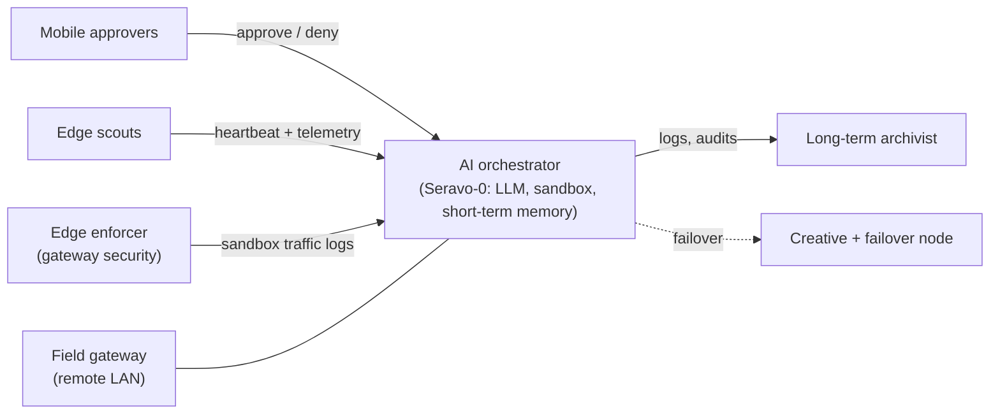

# Project 25/26 Seravo-0 / Sapor

> A private mesh network with an AI at its centre.

Seravo-0 is a large language model (LLM) built into the clients of a private mesh network. It watches the network around the clock, reports what it sees, and helps protect it. It never acts alone on anything important: a human approves or denies its actions from a phone.

Beside the network sits a creative project. A 20-year-old sci-fi/fantasy novel is being revived, and its world-building shares a home with the technical build. The two run on separate machines, so the creative work never touches the security work. Story details are deliberately kept out of this repository.

## The idea in one minute

Most home and small-site networks are watched by nobody. Devices join, firmware ages, cheap IoT gadgets talk to the internet, and problems show up only after something breaks.

This project puts a small team of machines on the job:

1. A **central brain** reads telemetry and logs, and reasons about them with a local LLM.
2. **Scouts** at the edge report in and show a local view.
3. An **enforcer** at the gateway isolates anything untrusted.
4. An **archivist** keeps the long-term record.
5. **You**, on a phone, say yes or no to anything consequential.

Everything runs locally. The LLM is hosted on the network's own hardware, not a cloud service, so network data stays inside it.

## Architecture at a glance



More detail: [docs/architecture.md](docs/architecture.md).

## Documentation

| Document | What's in it |
|---|---|
| [docs/architecture.md](docs/architecture.md) | Data flow, memory tiers, connectivity model |
| [docs/network-roles.md](docs/network-roles.md) | Every role and the four access tiers |
| [docs/monitoring-and-protection.md](docs/monitoring-and-protection.md) | How the network is watched and defended |
| [docs/principles.md](docs/principles.md) | The design rules the build follows |
| [docs/roadmap.md](docs/roadmap.md) | Clients and upgrades still to come |
| [docs/novel-and-seravo.md](docs/novel-and-seravo.md) | Where the creative project fits, and questions to explore |
| [docs/glossary.md](docs/glossary.md) | Short definitions of the terms used here |

## Repository layout

```
archive/
  <session-id>.md              # per-session notes/summary
  transcripts/
    <session-id>.jsonl         # raw transcript for the same session
docs/                          # overview documents listed above
```

Each session has one `.md` and one matching `.jsonl` sharing the same `<session-id>`. Real archive content is git-ignored; only the folder layout is tracked.

## What is not in this repository

Device names, IP addresses, subnets, keys, logs, raw transcripts and story details. The documents describe roles and design, not the live network.
