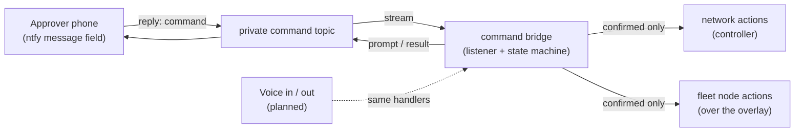

# Command bridge: two-way approval control

> **Status: private listener deployed; individual actions have different verification
> levels.** Not part
> of the public [starter kit](../starter-kit/README.md). No addresses, topics or
> credentials appear here; identifying values are `[REDACTED]` or `x-` placeholders.

This page describes how the design turns the one-way phone alert pipeline into a
**two-way** control channel — the concrete form of the project's founding principle:
*a person, on a phone, says yes or no to anything consequential.* It realizes the
**Approver phone (ntfy)** and sets the stage for the **Voice in / voice out (planned)**
node in [future integrations](future-integrations.md).

## What it is

The same private [ntfy pipeline](ntfy-alerts.md) that delivers state-change alerts also
carries **commands back**. Seravo-0 publishes an approval prompt; the operator replies
in the app's message field with a short command. A long-running listener parses the
reply, stages the action, and executes it only after an explicit second confirmation.

## Command families (role level)

- **Meta** — list pending approvals and the fleet/node summary; `confirm` / `deny`.
- **Network** — handlers request infrastructure reboots, controller client blocks,
  unblocks, reconnects and renames. SSID scheduling and DHCP toggles are implemented
  but not verified as effective network isolation. A DHCP toggle is not VLAN shutdown;
  an unblock is not client admission or proof that a device is trusted.
- **Fleet nodes** — handlers request reboot, lock, sleep and connectivity changes.
  Cutting the management path can prevent a later restore command from reaching it.
- **Tasks** — run a small allow-listed maintenance task.
- **Incident review** — explicitly acknowledge pending incidents without deleting the
  history or repairing devices. With no pending incidents, the reviewer skips model
  calls and notifications. New incidents may require review again.

Exact command words, topic names and host identifiers live only in the private
deployment and its private repository.

## Safety model

Consistent with every rule on the [future integrations](future-integrations.md) page and
the project [principles](principles.md):

1. **Read before write stays true** — the alert side is read-only; only an operator reply
   initiates change.
2. **Two-step confirm** — state-changing commands are staged with an expiry. Inspect the
   exact proposed action and targets: permissive target matching is a known limitation.
   Do not confirm an ambiguous or unexpected proposal.
3. **Limited self-sever guard** — selected connectivity cuts aimed at the controller
   host are rejected. This does not protect every infrastructure, reboot or sleep
   action. Independent recovery access remains necessary.
4. **Deduplication, not exactly-once execution** — message IDs are tracked, but offline
   replay and concurrent confirmation handling do not provide that guarantee.
5. **Private audit and recovery copies** — implemented command events are appended to
   a normal JSONL file, not immutable storage. Source and separate state snapshots are
   checksum-verified in restricted, same-host archive and backup locations. Secrets
   are excluded; these copies do not provide off-host disaster recovery.
6. **Independent human override remains a requirement** for anything affecting power
   or physical access; the command bridge does not supply that override.

## Verified status and open work

The private listener is active. Targeted automated tests cover parsing, approval and
denial, mocked actions, incident acknowledgment, zero-pending review suppression and
source-backup integrity. Earlier live checks covered a status reply, a staged then
denied request and harmless remote command execution; they did not reboot hardware.
Controller API acceptance alone does not establish successful remediation.

Endpoint lock/sleep/reboot, effective SSID shutdown, VLAN isolation and recovery after
cutting a management link are not verified. The client reconnection investigation is
also unresolved: wireless association without a controller-reported IP does not prove
a DHCP fault, and an offline observation alone cannot distinguish power loss from a
network problem. No power-cycle fix or new root-cause classifier is claimed here.

Public documentation carries only role-level status. Raw notification history, client
identities, incident evidence, configuration and runtime recovery copies remain private.

## Toward voice

The text parser accepts several natural phrasings. Voice input and arbitrary
two-way model conversation are still planned: topic permissions alone do not wire a
model to incoming messages. No public voice execution API is currently provided.
A future adapter must preserve target checks, approval and audit requirements rather
than bypass them.

## Repository

The implementation lives in a **private** repository, `seravo-command-bridge`, alongside
the rest of the private Seravo-0 logic. It is not published here and is not required to
run the public starter kit.
