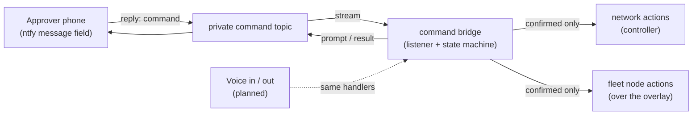

# Command bridge: two-way approval control

> **Status: architecture capability, implemented in the private deployment.** Not part
> of the public [starter kit](../starter-kit/README.md). No addresses, topics or
> credentials appear here; identifying values are `[REDACTED]` or `x-` placeholders.

This page describes how the design turns the one-way phone alert pipeline into a
**two-way** control channel — the concrete form of the project's founding principle:
*a person, on a phone, says yes or no to anything consequential.* It realizes the
**Approver phone (ntfy)** and sets the stage for the **Voice in / voice out (planned)**
node in [future integrations](future-integrations.md).

## What it is

The same private [ntfy pipeline](ntfy-alerts.md) that delivers state-change alerts also
carries **commands back**. Seravo-0 publishes an approval prompt; the operator replies
in the app's message field with a short command. A long-running listener parses the
reply, stages the action, and executes it only after an explicit second confirmation.

## Command families (role level)

- **Meta** — list pending approvals and the fleet/node summary; `confirm` / `deny`.
- **Network** — power-cycle LAN hardware; block or admit a client (the intruder
  kill-switch); reconnect, rename; disable or enable an SSID; stop or resume a VLAN.
- **Fleet nodes** — reboot, lock, or sleep a machine; cut or restore its overlay link;
  cut or restore its local network.
- **Tasks** — run a small allow-listed maintenance task.

Exact command words, topic names and host identifiers live only in the private
deployment and its private repository.

## Safety model

Consistent with every rule on the [future integrations](future-integrations.md) page and
the project [principles](principles.md):

1. **Read before write stays true** — the alert side is read-only; only an operator reply
   initiates change.
2. **Two-step confirm** — every state-changing command is staged and expires unless the
   operator sends a matching `confirm`. Fail-closed by default.
3. **Self-sever guard** — the bridge refuses any command that would cut its own host's
   connectivity, so it can never strand itself.
4. **Deduplicated** — a redelivered reply never executes twice.
5. **Archived audit** — every lifecycle event (requested → confirmed/denied → executed)
   is appended to an append-only trail that travels with the fleet backup.
6. **Human override is independent** — anything affecting heat, power or physical access
   still needs a manual override that does not depend on the AI or the network.

## Toward voice

The parser is intentionally **fluid**: natural phrasings map onto a single
`execute(action, params)` entry point. A planned local voice layer (speech in / speech
out, processed on the network's own hardware per rule 1) can call the same handlers, so
voice adds a new *input*, not a new *authority* — the two-step confirm and audit trail
remain in force.

## Repository

The implementation lives in a **private** repository, `seravo-command-bridge`, alongside
the rest of the private Seravo-0 logic. It is not published here and is not required to
run the public starter kit.
