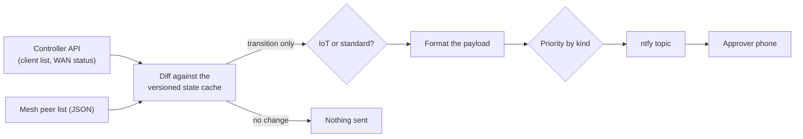

# Controller integration and alert pipeline

How the network controller's API, the mesh overlay and ntfy fit together. Endpoint paths, addresses, segment IDs, access point names, node names, file names and credentials are `[REDACTED]` or replaced by placeholders.

## 1. The controller API as the physical-layer sensor

Small Python wrappers talk to the TP-Link Omada controller through its local API. They log in with a dedicated account, and they trust the controller's self-signed certificate by pinning it explicitly. TLS verification is never switched off.

| What is read | Used for |
|---|---|
| **Client records** | Controller-assigned name, hardware identity, current address and link type (wired or Wi-Fi). |
| **Network list** | Maps a raw segment ID to its subnet and the name given in the controller, so alerts can say which segment a device is on. |
| **Wi-Fi telemetry** | Per client: signal strength, a signal-quality level, connected time and the serving access point. |
| **Gateway WAN status** | Which uplinks are up, whether traffic failed over, or whether every uplink is down. |

The wrappers are read-only by default. Anything that changes the network needs an explicit apply.

## 2. Access point alignment (signal optimiser)

Devices on a multi-access-point site, such as phones or IoT gear after boot, often cling to a distant access point. The optimiser nudges them.

1. **Detect.** A client counts as weak when its signal level is poor (below about 40) or its signal strength is below about -75 dBm.
2. **Stage the nudge.** It does not kick devices repeatedly. A reconnect request is sent once the client has been connected for about 15, 30 and 60 minutes, so it renegotiates and usually lands on a closer access point.
3. **Settle.** If the client is still weak after the last nudge, its best signal is recorded as "settled" and it is left alone for about two weeks, so there is no endless reconnect loop.
4. **Report.** A low-priority push says who was reconnected.

It runs dry-run until an apply flag is given.

## 3. From controller data to a phone alert



- **Only definitive changes alert.** Because each poll is diffed against the cache, a brief API timeout does not produce a ghost "device left" alert.
- **IoT or standard.** A device is tagged as IoT if its name says so or it sits on a tracked IoT segment.
- **Fixed format:**

```
[WLAN Connect] Name: (IoT) floodlight | IP: [REDACTED] | VLAN: [REDACTED] | AP: [REDACTED]
```

- **Priority.** Normal joins and leaves are default. If the controller reports every uplink down, the title changes to `WAN Drop: ALL UPLINKS DOWN` and the push goes out as urgent (priority 5), which on a phone can sound an alarm. More in [ntfy-alerts.md](ntfy-alerts.md).

## 4. Mesh events bypass the controller

The mesh overlay is read from its own status output, not from the controller. When a remote node joins from outside the site, such as a laptop on another network or the travel router, a separate event is sent. The segment field reads `N/A` because the node is not on a controller-managed segment:

```
[Tailscale Connect] Name: client-a | IP: [REDACTED mesh address] | VLAN: N/A
```

## 5. Other audits that arrive by push

| Audit | What it reports |
|---|---|
| **Fleet gap check** | A node is online on the mesh but is not yet being polled, with the reason, for example `[ONLINE BUT NOT POLLED] Name: client-b | State: no remote shell service`. Sent daily, and on change. |
| **Hardware collectors** | Once a node is adopted, its collector runs local OS commands and reports problems: a disk that is nearly full (for example 91%), a GPU driver that is not active, or a count of failed systemd units. |
| **Autosync result** | The reviewed repository is pushed to adopted Linux clients every 30 minutes. The push reports success per node, and flags any run that the handoff rules block, such as a script that contains an unredacted key and is stopped before it syncs. |

Examples with invented values: [report-examples.md](report-examples.md). Timetable: [polling.md](polling.md). Diagrams: [illustrations.md](illustrations.md).
