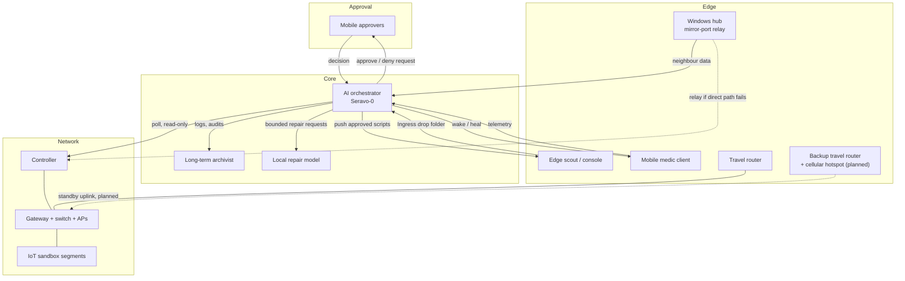

# Fleet clients: roles, hardware, interactions and status

Every client is described by its function. Hardware is named by vendor and product family so the build is real, but client names, exact model numbers, specifications, serials, addresses and hardware identities are withheld (`[REDACTED]`).

**How status was decided.** It comes from the project's own audit records and from past planning chats. Chat transcripts are plans, not proof, so anything only seen in a chat is marked *planned* or *in progress*. Where a recent audit could not verify a client, it says so.

| Status | Meaning |
|---|---|
| **Active** | Seen working in a recent audit or live job record. |
| **Active, degraded** | Running, but with a known access, identity or latency problem. |
| **In progress** | Partly built, or built but blocked on something. |
| **Planned** | Designed in prompts, not yet built or not yet seen working. |

## Hardware at a glance

| Vendor and family | Used for |
|---|---|
| **Dell Precision** laptops | The AI orchestrator (run headless) and the edge scout / operator console. |
| **Dell OptiPlex** micro-PCs | Candidates for the edge enforcer and the internal auditor. |
| **Dell 5000-series** laptop with a Thunderbolt link | Candidate for the dedicated archivist machine on an isolated direct link. |
| **Dell USB-C dock** | Wired network, display and peripherals for the operator console. |
| **Dell and other reconditioned laptops** | The golden-master laptop fleet, stamped from one image. |
| **Windows laptop and Windows PC** | The Windows hub and the Windows fleet node. |
| **Linux laptop with an NVIDIA GPU** | The mobile medic client. |
| **TP-Link Omada** | Hardware controller, wired gateway router, managed switch and Wi-Fi access points. |
| **GL.iNet** (OpenWrt) | Travel router. |
| **TP-Link travel router** (second unit) | Planned backup router with a cellular hotspot, for failover if the satellite uplink has problems. |
| **Samsung Galaxy** phone and tablet, other Android phone | Mobile approvers; a retired Galaxy phone is the planned quarantine buffer. |
| **Smartwatch** | Limited, read-only watch client. |
| **IoT** (floodlights, cameras, plugs, a thermostat, a home-automation gateway, Google Nest speakers, a TV, a printer) | Observed on isolated segments, never trusted. |

Exact models, specifications, serials and hardware identities: `[REDACTED]`.

## Inventory at a glance

The reviewed inventory holds about 40 records. Roughly a third are compute, mobile and network-infrastructure roles, and about two-thirds are IoT devices on an isolated segment. Each record carries a role, a hardware identity, a segment and a status. Records that cannot be verified stay marked as unconfirmed, and the AI is not allowed to send work to them.

## Compute and control clients

| Function | Hardware class | OS | What it does | Status |
|---|---|---|---|---|
| **AI orchestrator** (Seravo-0) | Dell Precision laptop, run headless `[REDACTED: model, specs]` | Linux | Runs the local LLM, the chat front end, the vault and ingest services, the scheduled jobs and the sandbox. Decides, dispatches and records. | **Active** |
| **Edge scout / operator console** | Dell Precision laptop on a Dell USB-C dock `[REDACTED: model]` | Linux | The operator's day-to-day console. Hosts the Ingress drop folder, a status HUD and the template for new clients. Acts as a mesh subnet router and exit point. | **Active**, remote shell access to it still being fixed |
| **Windows hub and mirror-port relay** | Windows laptop `[REDACTED: vendor and model]` | Windows | Relays the switch mirror port's neighbour data to the vault and stands in as the controller relay. Also serves as an archive target and mesh exit point. | **Active, degraded**: remote key authorisation is blocked and latency was seen on the relay path |
| **Mobile Linux medic client** | Linux laptop with an NVIDIA GPU, travels `[REDACTED: model]` | Linux | Sends telemetry to the orchestrator every five minutes and runs a local watchdog. Restricted by policy: it can report and query but cannot start SSH sessions. | **Active** |
| **Windows fleet node** | Windows PC `[REDACTED: model]` | Windows | General fleet member, woken on demand. | **Active, degraded**: offline at last audit, identity record conflicted |
| **Field gateway (stealth portal)** | Small Linux box | Debian | Subnet router for a remote or travelling LAN. | **Planned / unverified**: in the design roster, not seen in recent audits |
| **Reconditioned laptop fleet** | Reused Dell laptops of one family | Linux | Stamped from one "golden master" image and one idempotent install script so each client is identical. | **In progress** |
| **Repeat-build laptop** | Reconditioned Dell laptop | Linux | The next machine built from the golden master image. | **Planned** |

## Network and edge infrastructure

| Function | Hardware class | What it does | Status |
|---|---|---|---|
| **Network controller** | TP-Link Omada hardware controller | Holds the network's configuration: segments, DHCP, Wi-Fi and access points. | **Active**. Its management API cannot set a few options, so those are set by hand in its web interface. |
| **Gateway router** | TP-Link Omada wired VPN router | Routing, static routes, firewall rules. | **Active** |
| **Switch and access points** | TP-Link Omada managed switch and EAP Wi-Fi access points | Segment the network and carry the mirror port. | **Active**; identities not individually verified by the AI |
| **Edge enforcer** | Dell OptiPlex micro-PC (candidate), to sit between the uplinks and the gateway | Dual-uplink (satellite plus cellular) firewall, intrusion prevention, DNS filtering, transparent proxy and mirror telemetry. Fails closed. | **Planned**: hardware not yet placed in line |
| **Controller migration** | Same micro-PC | Moves the controller software into a container on the enforcer so the hardware controller can retire. | **Planned** |
| **Travel router** | GL.iNet travel router running OpenWrt | Brings a travelling LAN back into the mesh, with failover between uplinks. | **Active, intermittent** |
| **Backup travel router (cellular failover)** | Second travel router, TP-Link `[REDACTED: model]`, paired with a cellular hotspot `[REDACTED: carrier, plan, SIM]` | Standby uplink if the satellite service has problems. Takes over as the internet path, or feeds the edge enforcer's second uplink, and is probed regularly so failover is known to work before it is needed. | **Planned** (future build) |

## Mobile and wearable clients

| Function | Hardware class | What it does | Status |
|---|---|---|---|
| **Mobile approvers** (phone and tablet) | Android phone and Samsung Galaxy tablet | Approve or deny AI actions, approve new mesh routes, and wake or reboot a client in the field. | **Active** (phone); the tablet shows as offline at times |
| **Limited watch client** | Smartwatch | Read-only status and limited sync. | **Active in policy**, light use |
| **Mobile quarantine buffer** | Retired Samsung Galaxy phone | A scanning and landing drive. Files arrive, get virus-scanned, and pass on to the orchestrator for review. | **Planned** |

## Memory and archive

| Function | Hardware class | What it does | Status |
|---|---|---|---|
| **Long-term archivist (vault)** | Local disk on the orchestrator now; a Dell 5000-series laptop on a Thunderbolt direct link is the planned separate machine | Write-once history, logs, audits and chat exports. | **Active** (local vault). The dedicated machine on its own direct link is **Planned**. |
| **Internal auditor** | Dell OptiPlex micro-PC, CPU-only model (candidate) | Weekly review of sandbox traffic logs. | **Planned** |
| **Creative and failover node** | Server-class machine `[REDACTED: not yet chosen]` | Hosts the creative workspace and a second LLM. Takes over if the orchestrator loses its heartbeat. | **Planned** |
| **Credential vault** | Dedicated drive or host | Recovers a wiped client and reissues its identity. | **Planned** |

## IoT and sandbox devices
Security floodlights and cameras, smart plugs, an Emerson Sensi thermostat, a Legrand home-automation gateway, Google Nest smart speakers, a TV and a printer live on isolated segments, served by the TP-Link access points. They are observed, not trusted, and the orchestrator watches how they behave. Work in progress here includes onboarding problems on one segment, and a TV with no internet that needs a fix in the controller's web interface.

## How the clients interact

### Interaction rules in plain language
- **Hub and spoke.** Edge clients run a small reporting agent with no local LLM. They report to the orchestrator and take approved work from it.
- **LAN first, mesh second.** Clients use the local network when they can and the encrypted overlay when they cannot.
- **Identity before address.** The orchestrator finds a client by its hardware identity first. Addresses are only a last resort and never override hardware evidence. A client whose identity is in doubt gets no work.
- **Ingest.** A chat or note saved into the Ingress folder crosses to the vault, is archived and indexed, and is treated as information only. See [workflow.md](workflow.md).
- **Outbound scripts.** The orchestrator stages scripts it has reviewed, and a human approves them before they reach clients.
- **Wake and heal.** A healer checks a client over the LAN, then over the mesh, then wakes it using its registered hardware identity. Only clients marked wake-required are woken, and mobile clients only on explicit request.
- **Alerts.** Phone notifications fire on a state change only, not on every check.
- **Backup uplink (planned).** The backup travel router and its cellular hotspot stay idle until the satellite uplink degrades. A health probe will test them on a schedule and report the result, and an urgent alert fires if every uplink is down. See [polling.md](polling.md).
- **Controller access.** The orchestrator talks to the controller directly first, and falls back to a relay through the Windows hub. Certificate checks stay on.
- **Changes.** Nothing alters the live controller, the inventory or a trust anchor without an explicit apply step and a backup first.
- **External AI.** Cloud assistants are rate-limited by a token circuit breaker, so a runaway loop cannot spend the budget.

## Scheduled behaviour (shape only)
- A weekly maintenance window with a wake-up beforehand.
- A weekly auditor review.
- Frequent health, signal-tuning and IoT-guard checks, and daily fleet discovery.
- Hourly sync of the shared repository.

## Known open issues (honest status)
- Remote shell access to several clients is blocked on their side, and fingerprints are pinned only when supplied out of band.
- Some inventory records conflict on identity, so dispatch to those clients is disabled until a person confirms them.
- A few controller options cannot be set through its API and need the web interface.
- A credential found in a service file was quarantined and still needs rotating.
- The security-training simulation (honeypot segment, tarpit, quarantine, thermal breaker) was run as a dry run only. None of it is applied to the live network.
