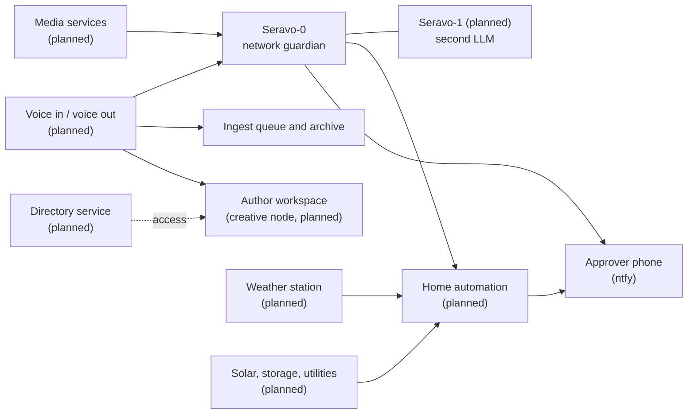

# Future integrations

Everything on this page is **planned or at idea stage**. Nothing here is live. Each entry says what it is for, how it would fit the existing design, and what is still open. Exact devices, products, addresses and configurations are `[REDACTED]` or not yet chosen.

## Rules every future integration follows

1. **Local first.** Audio, sensor data and utility data are processed on the network's own hardware, not by a third-party service.
2. **Read before write.** A new integration starts as read-only monitoring. Control comes later, behind dry-run and a human approval.
3. **Isolated by default.** New devices join an isolated segment. They are observed, not trusted.
4. **State-change alerts only,** through the same ntfy pipeline. See [ntfy-alerts.md](ntfy-alerts.md).
5. **Safety before convenience.** Anything that can affect heat, power or physical access needs a manual override that does not depend on the AI or the network.

## Overview

## Seravo-1: a second LLM

- **What.** A second local LLM instance alongside Seravo-0. Seravo-0 keeps its network-guardian directive. Seravo-1 would take on a different scope, with its own written directive, so neither model's instructions have to stretch.
- **Why.** Separate concerns (security versus the rest), a second opinion on a proposed action, and resilience if one model or machine is down. It also overlaps with the planned creative and failover node (see [fleet-clients.md](fleet-clients.md)).
- **Design.** Its scope would be written down before it is switched on. It would use the same handoff rules, the same human approval and the same fail-closed behaviour as Seravo-0, and no authority over network changes by default.
- **Open.** Which machine hosts it, what its directive covers, and how disagreement between the two models is settled (the usual answer: ask a person).

## Voice and voice-to-text

- **Capture.** Dictated notes, field commands and spontaneous ideas, recorded on a phone or a small room device.
- **Transcribe locally.** Speech-to-text runs on the local compute nodes, and audio never leaves the network.
- **Ingest.** The transcript goes into the same ingest queue as a saved chat, is archived, and is indexed into the vector memory so spoken context can be recalled later.
- **Voice out.** A local text-to-speech voice could read alerts or answers aloud.
- **Safety.** A spoken command is treated like any other message: information, not an order. A voice cannot approve a consequential action. Approval stays on the approver's phone.
- **Open.** Hardware for capture, wake-word versus push-to-talk, which models, and how the speaker is identified.

## Author workspace: voice-assisted story development

This is the creative side of the voice work. It runs on the creative node, kept apart from the security network, and **no story content goes into this repository**.

- **Brainstorm on the go.** Speak plot ideas, character thoughts or scene fixes into a phone. Local speech-to-text turns them into notes, and the notes land in the author's private workspace, tagged by thread (plot, character, world, timeline).
- **Keep the plot tight.** A continuity checker compares new notes with the private story bible: established facts, timelines, who knows what and when, and rules of the world. It flags contradictions, dropped threads and unexplained jumps, and asks questions instead of rewriting anything. The author decides.
- **Recall by voice.** "What did I decide about X?" is answered from the vector memory of earlier notes, with a pointer to the source note.
- **Capture first, organise later.** Raw transcripts are kept, and tidied notes are produced alongside them, never instead of them.
- **Privacy.** Story material stays on the creative node and the long-term archivist. The security network's AI does not read it by default.
- **Open.** Which notes format, how the story bible is structured, how conflicts are shown, and whether Seravo-1 (above) is the model that does this work.

## Directory services and author access

The author workspace and the other nodes would sit under one identity and access model, so who may reach what is decided in one place.

- **Idea.** A central directory service (Microsoft Active Directory, or an open equivalent such as LDAP) holding accounts, groups and access policy for the fleet and the author workspace. Groups would follow the existing four access tiers, and the author workspace would get its own group.
- **Why.** One place to add, change or remove access, sign-in that works across Windows and Linux, and an audit trail.
- **Fit.** The Windows hub is the natural early candidate for a directory role. Linux nodes would join through a standard client. The mesh overlay and its tags stay the network-level control, and the directory adds user-level control on top.
- **Safety.** Directory credentials are secrets like any other and stay out of the repository. The service sits on a trusted segment, with its own backup and a manual recovery path that does not depend on the AI.
- **Open.** Whether Active Directory itself or an open alternative is wanted, which machine hosts it, and how much of the fleet should join. If "fully active directory" meant something different, such as a live, always-synced directory of the author's own working files, the voice-and-notes pipeline above covers most of it.

## Home automation control

- **What.** A local home-automation hub (Home Assistant is the candidate) brings lights, plugs, thermostat and sensors under one roof.
- **Fit.** The hub sits on its own isolated segment. Seravo-0 first watches it (is it up, are its devices joining and rejoining). Control by the AI is a later step with a short list of allowed actions and human approval for anything consequential.
- **Likely first uses.** Scenes and schedules, alerts that combine network and device state, and a status view on a wall or tablet display.
- **Open.** Which devices are controllable, which protocols, and what the AI may do without asking.

## Media

- **What.** Media services and devices (streaming boxes, a TV, speakers, a printer) are already present on the network and are watched for presence only. Further capability is open: a local media library and server, and room audio that could carry voice-out announcements.
- **Fit.** Household segment, local storage, no cloud account needed for the core function.
- **Open.** What the media stack should be, where storage lives, and whether it uses the long-term archivist or a separate device.

## Weather station

- **What.** A local weather station giving readings such as temperature, humidity, wind, rain and pressure.
- **Why.** Feeds home automation (frost, wind and storm rules), and gives weather context to the nightly audit and daily briefing. It also helps explain events like a signal drop in heavy rain or a satellite link that degrades in a storm.
- **Fit.** A read-only sensor feed into the same state and report pipeline, with a short weather line added to the morning briefing.
- **Open.** The station and sensors, how they connect, and what thresholds should alert.

## Solar and utilities

- **What.** A future solar and storage build, plus monitoring of utilities: power use, generation, storage state, water, fuel and similar.
- **Why.** Keeps the network up through an outage, and tells the operator how much headroom there is for heavy jobs such as burst compute (see [roadmap.md](roadmap.md)).
- **Fit.** Read-only monitoring first, reported by push: generation, storage level, grid state, and an alert when the network's own power is at risk. Later, load-aware scheduling: heavy local AI jobs when there is surplus power, and spare nodes put to sleep when there is not.
- **Safety.** Automatic control of electrical equipment is out of scope until it has been designed with qualified help. A hardware override must always work without the network.
- **Open.** Equipment, which readings are exposed locally, and what a power-loss plan looks like (the backup travel router and cellular hotspot on the [roadmap](roadmap.md) are part of it).

## How these tie to what exists

| Need | Existing piece it builds on |
|---|---|
| Alerts | The ntfy pipeline and state-change rules |
| Polling a new device | The identity-first resolver and heartbeat pattern ([polling.md](polling.md)) |
| Memory of spoken or sensor context | Ingest queue and vector memory ([workflow.md](workflow.md)) |
| Approval | The approver phones |
| Power-aware jobs | Burst compute and Wake-on-LAN |
