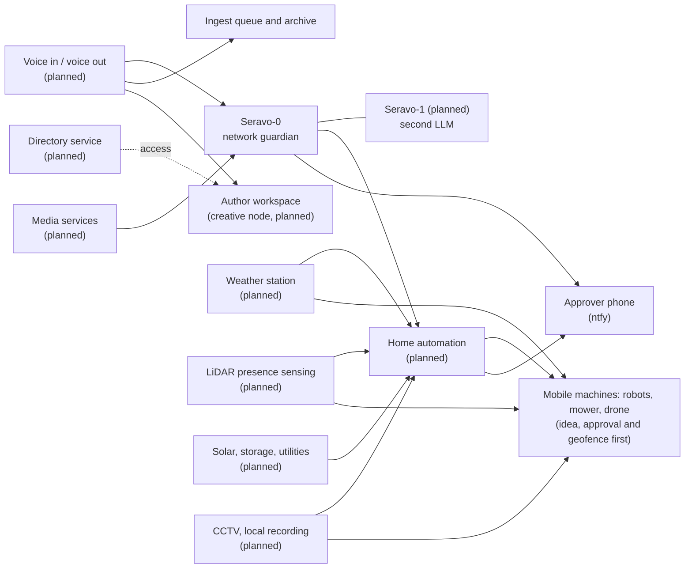
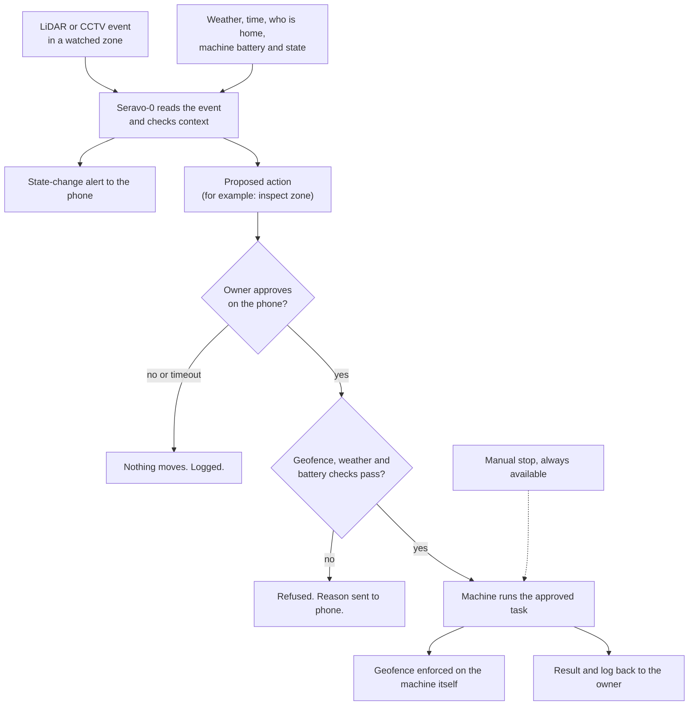

# Future integrations

Everything on this page is **planned or at idea stage**. Nothing here is live. Each entry says what it is for, how it would fit the existing design, and what is still open. Exact devices, products, addresses and configurations are `[REDACTED]` or not yet chosen.

## Rules every future integration follows

1. **Local first.** Audio, sensor data and utility data are processed on the network's own hardware, not by a third-party service.
2. **Read before write.** A new integration starts as read-only monitoring. Control comes later, behind dry-run and a human approval.
3. **Isolated by default.** New devices join an isolated segment. They are observed, not trusted.
4. **State-change alerts only,** through the same ntfy pipeline. See [ntfy-alerts.md](ntfy-alerts.md).
5. **Safety before convenience.** Anything that can affect heat, power or physical access needs a manual override that does not depend on the AI or the network.

## Rave: planned, disabled

No verified Rave connector was found. Do not infer a product, API or operational integration from the name. Before implementing an adapter, identify the exact interface/product/version and read-only schema, the authentication/scopes/private credential and trust requirements, and the privacy/data-flow/retention/consent policy. These [exact outstanding prerequisites](monitoring-and-protection.md#connectors-and-rave) keep the maintenance connector disabled. Configuration metadata alone is not a connector or successful observation.

## Overview

## Seravo-1: a second LLM

- **What.** A second local LLM instance alongside Seravo-0. Seravo-0 keeps its network-guardian directive. Seravo-1 would take on a different scope, with its own written directive, so neither model's instructions have to stretch.
- **Why.** Separate concerns (security versus the rest), a second opinion on a proposed action, and resilience if one model or machine is down. It also overlaps with the planned creative and failover node (see [fleet-clients.md](fleet-clients.md)).
- **Design.** Its scope would be written down before it is switched on. It would use the same handoff rules, the same human approval and the same fail-closed behaviour as Seravo-0, and no authority over network changes by default.
- **Open.** Which machine hosts it, what its directive covers, and how disagreement between the two models is settled (the usual answer: ask a person).

## Voice and voice-to-text

- **Capture.** Dictated notes, field commands and spontaneous ideas, recorded on a phone or a small room device.
- **Transcribe locally.** Speech-to-text runs on the local compute nodes, and audio never leaves the network.
- **Ingest.** The transcript goes into the same ingest queue as a saved chat, is archived, and is indexed into the vector memory so spoken context can be recalled later.
- **Voice out.** A local text-to-speech voice could read alerts or answers aloud.
- **Safety.** A spoken command is treated like any other message: information, not an order. A voice cannot approve a consequential action. Approval stays on the approver's phone.
- **Open.** Hardware for capture, wake-word versus push-to-talk, which models, and how the speaker is identified.

## Author workspace: voice-assisted story development

This is the creative side of the voice work. It runs on the creative node, kept apart from the security network, and **no story content goes into this repository**.

- **Brainstorm on the go.** Speak plot ideas, character thoughts or scene fixes into a phone. Local speech-to-text turns them into notes, and the notes land in the author's private workspace, tagged by thread (plot, character, world, timeline).
- **Keep the plot tight.** A continuity checker compares new notes with the private story bible: established facts, timelines, who knows what and when, and rules of the world. It flags contradictions, dropped threads and unexplained jumps, and asks questions instead of rewriting anything. The author decides.
- **Recall by voice.** "What did I decide about X?" is answered from the vector memory of earlier notes, with a pointer to the source note.
- **Capture first, organise later.** Raw transcripts are kept, and tidied notes are produced alongside them, never instead of them.
- **Privacy.** Story material stays on the creative node and the long-term archivist. The security network's AI does not read it by default.
- **Open.** Which notes format, how the story bible is structured, how conflicts are shown, and whether Seravo-1 (above) is the model that does this work.

## Directory services and author access

The author workspace and the other nodes would sit under one identity and access model, so who may reach what is decided in one place.

- **Idea.** A central directory service (Microsoft Active Directory, or an open equivalent such as LDAP) holding accounts, groups and access policy for the fleet and the author workspace. Groups would follow the existing four access tiers, and the author workspace would get its own group.
- **Why.** One place to add, change or remove access, sign-in that works across Windows and Linux, and an audit trail.
- **Fit.** The Windows hub is the natural early candidate for a directory role. Linux nodes would join through a standard client. The mesh overlay and its tags stay the network-level control, and the directory adds user-level control on top.
- **Safety.** Directory credentials are secrets like any other and stay out of the repository. The service sits on a trusted segment, with its own backup and a manual recovery path that does not depend on the AI.
- **Open.** Whether Active Directory itself or an open alternative is wanted, which machine hosts it, and how much of the fleet should join. If "fully active directory" meant something different, such as a live, always-synced directory of the author's own working files, the voice-and-notes pipeline above covers most of it.

## Home automation control

- **What.** A local home-automation hub (Home Assistant is the candidate) brings lights, plugs, thermostat and sensors under one roof.
- **Fit.** The hub sits on its own isolated segment. Seravo-0 first watches it (is it up, are its devices joining and rejoining). Control by the AI is a later step with a short list of allowed actions and human approval for anything consequential.
- **Likely first uses.** Scenes and schedules, alerts that combine network and device state, and a status view on a wall or tablet display.
- **Open.** Which devices are controllable, which protocols, and what the AI may do without asking.

## LiDAR

I have read "lindar" as LiDAR (laser ranging). If you meant something else, tell me and I will change this section.

- **What.** LiDAR sensors that measure distance and shape instead of recording images. Likely uses: presence and movement sensing for doors, yards and halls, room occupancy for home automation, and mapping a space.
- **Why LiDAR rather than cameras.** It tells the system that something is there and where it is, without keeping anyone's picture. That fits the project's privacy stance.
- **Fit.** Sensors sit on the isolated IoT segment and report to the local home-automation hub. Seravo-0 watches them like any other IoT device (present, rejoined, silent) and treats a sensor that goes quiet as an alert in its own right. Events such as "motion at the gate at night" arrive as state-change pushes.
- **Safety and privacy.** Data stays local, and aiming is limited to the household's own property. A physical-security alert is information for a person, not a trigger for automatic action.
- **Open.** Sensor type and mounting, how it connects, and which events deserve a push.

## Future IoT aspirations

The IoT segment today holds lights, cameras, plugs, a thermostat, a home-automation gateway, speakers, a TV and a printer. The aim is to grow it without growing the risk.

| Aspiration | What it means |
|---|---|
| **More sensors, same rules** | Weather, power, LiDAR presence and similar sensors join the isolated segment, and each one is watched for joins, drops and silence. |
| **Device onboarding checklist** | A new device gets a role, a fixed address reservation where needed, and a place in the reviewed inventory before it is trusted with anything. Unknown devices still raise an alert. |
| **Local-only by default** | Devices that work without a cloud account are preferred. Those that need the internet are limited to what they must reach. |
| **Per-device behaviour baselines** | The IoT guard learns what normal looks like for each device (how long it takes to rejoin, how often it chatters) and flags drift. |
| **Health and lifecycle** | Firmware age, battery level and last-seen time are tracked, with a push when a device needs attention. |
| **Power-aware devices** | Where safe, devices respond to the solar and utilities state (see below). |
| **Quarantine and containment** | A misbehaving device can be moved to a stricter segment, after a person approves. The honeypot and quarantine playbooks on the [roadmap](roadmap.md) cover the practice runs. |
| **Open standards** | Prefer devices that speak open local protocols over closed ones, so the hub does not depend on one vendor. |

## Physical security, geofencing and mobile machines

This is the furthest-out idea on the page. It covers sensors that notice something on the owner's own property, and machines that can move: drones, robot vacuums, lawn mowers and similar. Everything stays on the owner's own land and inside the owner's own network.

### The pieces

| Piece | Role | Status |
|---|---|---|
| **LiDAR perimeter and zone sensing** | Notices movement or presence in a defined zone without recording faces. See [LiDAR](#lidar). | Idea |
| **CCTV with local recording** | Cameras record to a local recorder only, with no cloud account. Seravo-0 reads **event metadata** (motion, zone, time), not the video itself, unless the owner opens a clip. | Idea |
| **Geofence** | A boundary drawn around the owner's property (and smaller no-go zones inside it). Used to limit where any mobile machine may go and to flag when something crosses a line. `[REDACTED: boundary, coordinates, zones]` | Idea |
| **Mobile machine controller** | One adapter per machine type that translates an approved request ("start the mower", "inspect the north fence") into that machine's own control interface. `[REDACTED: devices, protocols, pairing keys]` | Idea |
| **Approval and override layer** | Decides whether a request is allowed, who must approve it, and how it is stopped. | Idea |

### Machine classes

| Class | Examples | Typical use | Notes |
|---|---|---|---|
| **Robot vacuums** | Floor cleaners | Run when the home is empty, pause when someone is present, report stuck, full bin and low battery. | Lowest risk. A good first machine. |
| **Lawn mowers** | Robotic mowers | Schedule by weather, hold in rain, stay inside the geofence, alert if lifted or moved outside the boundary. | Blades: must stop when anyone or anything is detected in the zone. |
| **Other ground robots** | Pool, window, gutter or snow robots | Same pattern: schedule, weather gate, status alerts. | One adapter per type. |
| **Drones** | Small multirotor | Inspect the roof, solar panels or fence line on request, and check an alerted zone. | Highest risk, so last. Observation only (see rules below). |

### Control modes

| Mode | Meaning | Needs approval? |
|---|---|---|
| **Monitor only** | Read battery, state, errors. No commands. | No |
| **Direct control** | The owner drives or starts the machine from the dashboard or phone. | The owner is the approval. |
| **Scheduled routine** | A reviewed routine (for example weekly mowing, daily vacuum) inside an approved window. | Once, when the routine is set up |
| **Sensor-triggered, supervised** | A LiDAR or CCTV event proposes an action ("check the north fence"). The owner approves on the phone before anything moves. | Yes, every time |
| **Autonomous within an envelope** | The machine acts alone inside a written limit (zone, time, battery, weather). | Only for low-risk classes, and only after a long supervised period |

### How a triggered action flows

### Safety rules (non-negotiable)

1. **Own property only.** Machines operate only inside the owner's boundary. Nothing records or flies over a neighbour or the public.
2. **Law first.** Drones are subject to aviation rules: registration, pilot qualification, line of sight, height limits, no-fly areas and privacy law. The owner checks the local rules before any flight. The system does not replace that duty. `[Open: which rules apply]`
3. **Observation only.** No payloads, no weapons, no devices meant to harm, and no pursuit, approach or deterrence of any person or animal. A detection produces a **report to the owner**, not a confrontation. If someone's safety is at risk, the answer is the owner and the emergency services, not a machine.
4. **Human in the loop.** Sensor-triggered action needs approval each time. A drone never launches on its own authority.
5. **Geofence enforced on the machine,** not only in the AI. If the AI, the hub or the network fails, the machine still stays inside its limit and returns or stops.
6. **Fail safe.** On lost link, low battery, bad weather or any doubt: stop, hold or return. Never continue.
7. **Manual override that does not depend on the AI or the network:** a physical stop and a manual remote.
8. **Weather and battery gates,** using the weather station and the machine's own state.
9. **Privacy by design.** LiDAR is preferred over cameras where it is enough. Cameras get privacy masks for anything off the property. Retention is short and local. Footage is never sent to a cloud service.
10. **Everything is logged,** with who approved what and when, and the log goes to the archive.
11. **Isolated and hardened.** Machines sit on the isolated IoT segment, with credentials in the vault and no direct access to the internet where avoidable. Mobile machines are a physical risk **and** an attack surface, so they get the same quarantine and review as any new device.
12. **No dual use by accident.** A machine may do the task it was approved for and nothing else. New abilities need a new written approval.

### Rollout, in order

1. **Monitor only.** Battery, state, stuck and error alerts for vacuums and the mower.
2. **Direct control** from the dashboard and phone.
3. **Scheduled routines** with weather and presence gates.
4. **LiDAR and CCTV events** feeding alerts and the daily report (no machine movement).
5. **Sensor-triggered, supervised** action for ground machines.
6. **Drone** monitor and manual use only, then supervised inspection flights, if the legal and safety questions are settled. Autonomous drone use is **not** a goal until then.

### What stays redacted

Machine makes and models, protocols and pairing keys, control endpoints, geofence boundaries and coordinates, patrol and flight paths, camera positions and fields of view, blind spots, recorder location and access details. Those are exactly what someone would need to defeat the system, so they are not in this repository.

### Open

- Which machines come first, and which adapters are worth building.
- Local rules for drones and camera use at the property, and whether a licence is needed.
- How the geofence is enforced on each device type, and what the fallback is when a device has no geofence support.
- How long CCTV events and clips are kept.
- Whether LiDAR alone can cover most zones so fewer cameras are needed.
- Whether any machine should ever act without approval, and under what limit.

## Media

- **What.** Media services and devices (streaming boxes, a TV, speakers, a printer) are already present on the network and are watched for presence only. Further capability is open: a local media library and server, and room audio that could carry voice-out announcements.
- **Fit.** Household segment, local storage, no cloud account needed for the core function.
- **Open.** What the media stack should be, where storage lives, and whether it uses the long-term archivist or a separate device.

## Weather station

- **What.** A local weather station giving readings such as temperature, humidity, wind, rain and pressure.
- **Why.** Feeds home automation (frost, wind and storm rules), and gives weather context to the nightly audit and daily briefing. It also helps explain events like a signal drop in heavy rain or a satellite link that degrades in a storm.
- **Fit.** A read-only sensor feed into the same state and report pipeline, with a short weather line added to the morning briefing.
- **Open.** The station and sensors, how they connect, and what thresholds should alert.

## Solar and utilities

- **What.** A future solar and storage build, plus monitoring of utilities: power use, generation, storage state, water, fuel and similar.
- **Why.** Keeps the network up through an outage, and tells the operator how much headroom there is for heavy jobs such as burst compute (see [roadmap.md](roadmap.md)).
- **Fit.** Read-only monitoring first, reported by push: generation, storage level, grid state, and an alert when the network's own power is at risk. Later, load-aware scheduling: heavy local AI jobs when there is surplus power, and spare nodes put to sleep when there is not.
- **Safety.** Automatic control of electrical equipment is out of scope until it has been designed with qualified help. A hardware override must always work without the network.
- **Open.** Equipment, which readings are exposed locally, and what a power-loss plan looks like (the backup travel router and cellular hotspot on the [roadmap](roadmap.md) are part of it).

## How these tie to what exists

| Need | Existing piece it builds on |
|---|---|
| Alerts | The ntfy pipeline and state-change rules |
| Polling a new device | The identity-first resolver and heartbeat pattern ([polling.md](polling.md)) |
| Memory of spoken or sensor context | Ingest queue and vector memory ([workflow.md](workflow.md)) |
| Approval | The approver phones |
| Safe physical control | Dry-run default, approval each time, quarantine of new devices, and logs in the archive |
| Power-aware jobs | Burst compute and Wake-on-LAN |
