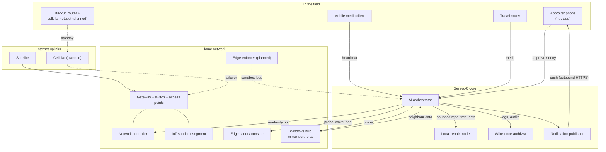
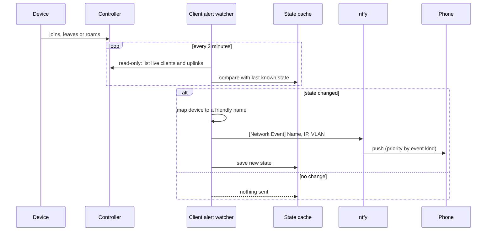
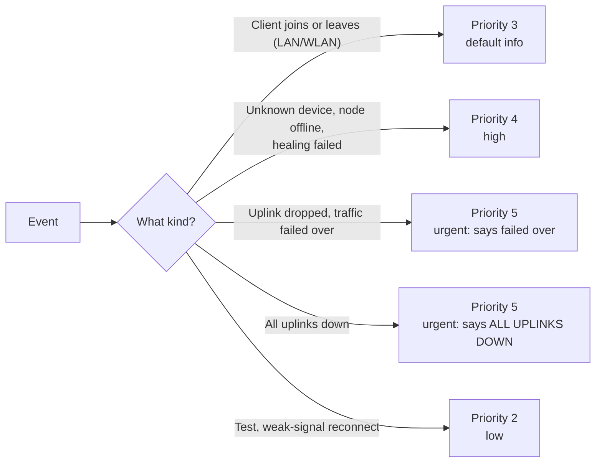
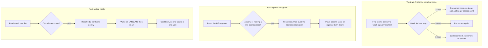
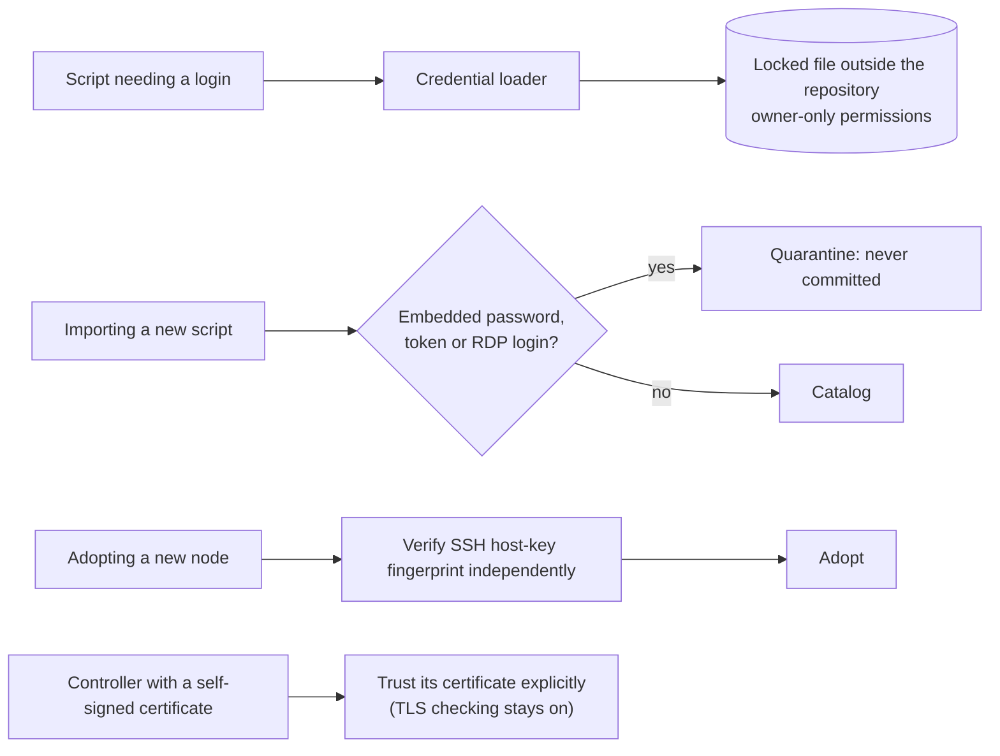
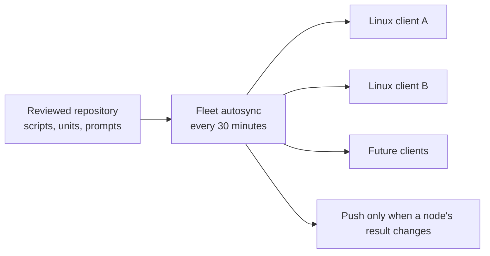
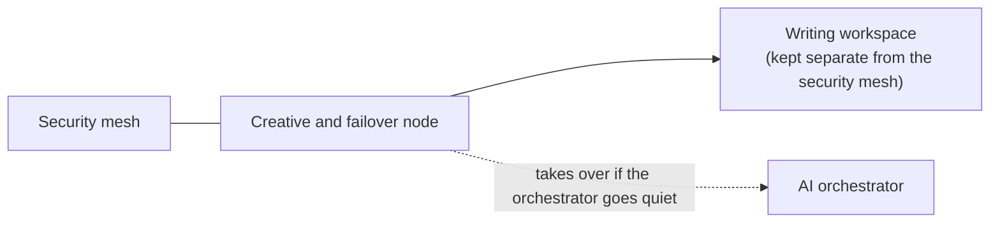

# Illustrations: how it all fits together

Diagrams only show roles and flows. Names, addresses, schedules in exact form and file paths are `[REDACTED]`. The diagrams render on GitHub.

## 1. The big picture



## 2. From a network event to a phone alert



The payload format is fixed, so every alert reads the same way:

```
[<Network type> <Event>] Name: <mapped client name> | IP: <address> | VLAN: <segment>
```

In real messages the address and segment are redacted in this repository. See [report-examples.md](report-examples.md).

### Escalation



## 3. Self-healing loops



All three run dry-run until an apply flag is given. The healer only wakes clients marked wake-required.

## 4. Credential hygiene



## 5. Self-regenerating fleet



Every adopted Linux client receives the same scripts, scheduled-job definitions and prompts, so the whole fleet learns a new protocol at the same time.

## 6. Where the novel fits



See [novel-and-seravo.md](novel-and-seravo.md).
