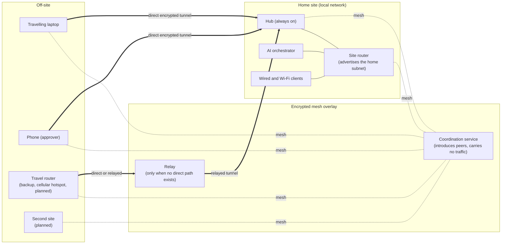
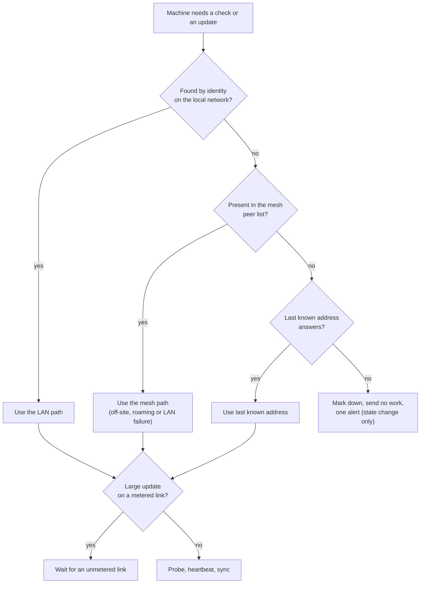

# Mesh, local and off-site: how everything connects and updates

The fleet lives on two kinds of path: the **local network** at home, and an **encrypted mesh overlay** (Tailscale) that follows each machine wherever it goes. This page explains how the two work together, how updates of every kind travel, and what happens when a machine is off-site. Tags, access rules, routes, keys, device names and addresses are `[REDACTED]`.

Status labels: **Active** means in use. **Planned**, **Idea** and **Open** mean not confirmed or not built.

These labels describe historical/private-system reports, not a fresh live audit. The public kit only reads optional Tailscale CLI state and probes configured ports; it does not configure routes, enforce ACLs or distribute updates. The [project monitor](monitoring-and-protection.md#local-project-maintenance) checks local evidence, not the mesh itself.

## The idea in one picture

The coordination service only introduces machines to each other. Traffic flows machine to machine in encrypted tunnels, and goes through a relay only when a direct path is impossible (for example, two machines behind strict networks).

## What Tailscale does here

| Job | Detail | Status |
|---|---|---|
| **Joins every client** | Each machine runs the mesh client, so the hub can reach it by a stable mesh name whether it is on the LAN, at another site or on a phone hotspot. | Active |
| **LAN-first, mesh-fallback** | Machines use the wired LAN for internal traffic. If the local link fails, or they are away, they fall back to the mesh. | Active |
| **Cryptographic reachability** | The hub reads the overlay's peer list (command line, JSON output). A peer that answers there is known to be alive even where ICMP ping is blocked. | Active |
| **Mesh names** | Machines are addressed by name, not by number, so a change of address does not break scripts. | Active |
| **Site subnet routing** | Only designated, always-on machines advertise a site's subnet into the mesh. Mobile devices never do, which prevents routing loops. | Active |
| **Connect and disconnect alerts** | When a machine joins or leaves the mesh, one ntfy push says so, using the standard fixed format. See [report examples](report-examples.md). | Active |
| **Role-based access rules** | Machines are grouped by role and may reach only what their role needs. `[REDACTED: tags, ACLs, routes]` | Active (details withheld) |
| **Phone as approver** | The phone joins the mesh so the owner can approve actions and read the dashboard from anywhere, with no port opened to the internet. | Active |
| **Private services over the mesh** | Dashboards, the alert server and the AI interface are reachable only through the mesh, not the public internet. | Active (role level) |
| **Device approval on join** | A new machine joins in a pending state and works only after the owner approves it. | Planned |
| **Exit node** | Route a travelling machine's traffic home through the hub on untrusted networks. | Planned |
| **Key expiry watch** | Alert before a machine's mesh login expires, so a long-absent laptop does not drop off silently. | Idea |
| **Mesh file transfer** | Move a file between two of the owner's machines without going through any cloud service. | Idea |
| **Mesh-native remote shell** | Use the mesh's own identity-based login instead of long-lived SSH keys on machines where that is safer. | Idea |
| **Self-hosted coordination** | Run the coordination service on the owner's own hardware, for full independence from the vendor. | Idea |
| **Ordinary-DNS fallback** | If mesh names stop resolving, fall back to the last known mesh address instead of failing. | Idea |

## How a machine is found

The resolver always works in the same order. It is covered in [polling](polling.md); in short:

1. **Local neighbour table**, by hardware identity (identity before address).
2. **Mesh peer list**, so the machine is found even when it is off the LAN.
3. **Last known address**, as a last resort.

If none of these resolve, the machine is marked down and **no work is sent to it**.

## What "update" means: six kinds, six paths

Everything is pushed by the hub or applied in a reviewed window. Clients never pull new code from the open internet on their own.

| Kind of update | How it travels | Status |
|---|---|---|
| **Scripts, scheduled-job definitions and prompts** | The hub's autosync pushes the reviewed set to each adopted Linux client every 30 minutes, over SSH with a pinned key. Identity is resolved first, so a push never goes to the wrong machine. | Active |
| **Heartbeats and health** (the other direction) | Each client writes a small health file and the hub collects it over LAN or mesh. A stale file raises one "online but not reporting" alert. | Active |
| **Windows node** | Receives the same reviewed content through its own agent, since Windows has different tooling. | Active (role level) |
| **Operating-system updates** | A standard weekly update window per client. The result is reported by heartbeat. | Planned |
| **Mesh client and container images** | Kept current in the same weekly window, one machine first as a canary. | Planned |
| **Local models** | New model files are fetched once to the hub or orchestrator, checked, then shared inside the network, so clients never download them separately. | Idea |

### Local, off-site and both

| Situation | What happens |
|---|---|
| **On the LAN** | Push goes over the wired network to the resolved address. |
| **Off-site, over the mesh** | The same push is intended to run to the machine's mesh address. A machine that is away catches up at its next reachable sync, because each sync is idempotent. **Open:** confirm autosync covers mesh-only clients. |
| **Asleep or off** | Skipped, not failed. It gets the next sync when it returns. Wake-on-LAN is used only for machines flagged as allowed, only on the local network and only with `--apply`. |
| **On a metered link** (phone hotspot or cellular backup) | Large updates wait for an unmetered link. Small syncs and heartbeats still go through. Planned. |
| **Away for a long time** | One alert says how long it has been silent. Nothing is forced. |
| **Home internet down** | Local traffic is unaffected. Off-site mesh peers cannot reach home until a failover uplink or the backup router is up. |

### Rules updates follow

- **Hub pushes, clients do not fetch.** The set of things a client runs is the set the owner reviewed.
- **Read before write, dry-run by default.** A sync can print what it would change before it changes anything.
- **One machine first.** Risky updates (operating system, container images, mesh client) go to one low-risk machine, then wait for it to report healthy before the rest.
- **Rollback ready.** A copy of what was replaced is kept so a bad update can be undone. Planned for the operating-system window.
- **Offline is normal.** A sleeping or travelling machine is not an error.
- **A blocked sync is an alert.** If a push cannot continue (for example a host key no longer matches), one "SYNC BLOCKED" push says so rather than forcing it.
- **No secrets in the sync.** Credentials stay in an owner-only file on each machine and never travel with scripts.
- **Approval for the consequential.** Anything that restarts a service or reboots a machine needs the owner's approval, except routine steps inside an approved window.

## The decision path

## Expanding: a new site or a travelling kit

Planned steps, each with the owner's approval:

1. **Join the mesh** with a role tag, in a pending state first (no routes accepted).
2. **Review.** The owner approves the machine in the inventory (insta-join on the [roadmap](roadmap.md)).
3. **Adopt.** Host-key pinning, then the first dry-run sync.
4. **Designate a site router** (always-on machines only) if the site has a local subnet to share.
5. **Enable alerts and heartbeat** for the site, with state-change-only rules.
6. **Review access rules** so the new machine can reach only what its role needs.
7. **Decide the update ring:** canary, early or late.

### Two sites

A second site is polled by the home hub through the mesh at first. If the link is poor, it gets its own small hub that reports upward, so a site keeps working on its own when the connection is down. Two sites must never advertise overlapping address ranges. `[REDACTED: address plan]`

## Failure modes

| Failure | Effect | Response |
|---|---|---|
| Coordination service unreachable | Existing tunnels keep working. New joins and key changes wait. | Idea: show it as a distinct status, not as every machine down. |
| Relay in use | Slower, still encrypted. | Report as "relayed" so a slow link has a visible cause. Idea. |
| Mesh login expired | Machine drops off the mesh. | Key-expiry watch and an owner re-login. |
| Subnet router down | Off-site peers lose the home subnet, not each other. | Alert on the router, with a second designated router as a backup. Planned. |
| Mesh and LAN both down | Machine is unreachable. | Marked down, one alert, no work sent. |
| Lost or stolen device | Risk of unauthorised mesh access. | Remove it from the mesh at once and rotate anything it held. |

## Safety and privacy

- The mesh is encrypted end to end. The coordination service sees which machines are connected, not what they say.
- No inbound ports are opened on the home router for remote access.
- Access rules, tags, routes, node keys, mesh names and addresses are redacted in this repository.
- Subnet routing is limited to a few always-on machines. A phone or laptop must never be a router.
- A device that is lost, sold or retired is removed from the mesh as part of the same checklist that removes it from the inventory.

## Open questions

- Does the 30-minute autosync reach mesh-only clients today, or only LAN-resolved ones?
- Should a travelling laptop use the home exit node by default, or only on untrusted networks?
- Which update schedule suits Windows versus Linux?
- Should a second site have its own hub from the start?
- Is a self-hosted coordination service worth running, given the added maintenance?
- Which updates, if any, may skip the canary step?
