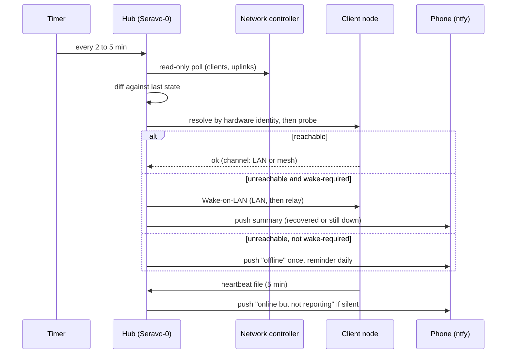

# Polling: how every client is checked

Nothing in this network is trusted to report on its own. The hub polls, the clients send heartbeats, and several independent watchers cross-check each other. This page describes the shape of that system. Addresses, schedules in exact form, hostnames and commands are `[REDACTED]`.

**Scope:** this is the broader target/private-system timetable, not a list of jobs deployed by this public repository. The kit supplies two-minute fleet polling, five-minute heartbeat/healer units and a daily report; the optional project check is hourly. Installation leaves every timer disabled until a person enables it. See [project maintenance](monitoring-and-protection.md#local-project-maintenance) and the [script guide](../starter-kit/SCRIPT_GUIDE.txt).

## The four ways information moves

| Pattern | Direction | Used for |
|---|---|---|
| **Hub polls controller** | Hub to network controller (read-only API) | Who is on the network, on which segment, on which access point, signal strength, uplink state, gateway telemetry. |
| **Hub probes client** | Hub to client | Is the client reachable, and by which path (LAN, mesh or last-known address)? Wake it if it is allowed to be woken. |
| **Client heartbeat** | Client to hub | Small health file (load, memory, disk, time) written locally and collected by the hub. Silence means trouble. |
| **Hub pushes to clients** | Hub to clients | Reviewed scripts, standards and catalog, synced on a schedule over pinned-key SSH. Credentials are never copied. |

A fifth path runs sideways: the Windows hub watches the switch mirror port and hands its neighbour data to the vault, and acts as a relay to the controller if the direct path fails.

## Polling timetable

| What is checked | Who checks | How often | Output |
|---|---|---|---|
| Client joins and leaves, mesh peers, uplink state | Client alert watcher | Every 2 minutes | Push on change only |
| Gateway telemetry: bottlenecks and anomalies | Gateway sentinel | Every 3 minutes | Push on change only |
| Fleet reachability and wake-up | Fleet healer | Every 5 minutes | Push when something recovers or does not |
| Weak-signal Wi-Fi clients | Signal optimiser (dry-run unless applied) | Every 5 minutes, staged at 15, 30 and 60 minutes | Push on reconnect |
| IoT reconnect watch | IoT guard | Every 5 minutes | Push when absent, failed, or rejoined |
| Mirror-port status from the Windows hub | Hub pull | Every 5 minutes | Status file for the unknown-device watcher |
| Mobile medic client telemetry | Client heartbeat | Every 5 minutes | Health file; hub flags silence |
| Script and standard sync to clients | Fleet autosync | Every 30 minutes | Push only when a node's result changes |
| Script registry refresh | Registry job | Hourly | Searchable catalog |
| Link speed and satellite dish stats | Speed poller | Every 4 hours | Push report |
| Nightly audit with AI analysis | Nightly audit | 02:00 | Archived report and push |
| Log rotation | Log rotator | 03:30 | Quiet, warns if a log is filling |
| Morning briefing | Morning report | 07:00 | Push |
| Daily status | Status report | 07:10 | Push |
| Hardware overview | Hardware report | 07:20 | Push |
| AI, pipeline and mesh overview | Stack report | 07:30 | Push |
| Fleet census | Census | 08:00 | Push |
| Online-but-not-polled gap check | Fleet bootstrap | 08:17 | Push on change only |
| Weekly maintenance and auditor review | Scheduled | Weekly | Wake-up beforehand |

The broader design schedules these with systemd timers. The public kit does not include the stack report or automatically inspect live service/timer results; reviewed evidence must supply the required maintenance checks.

## How a client is found: identity before address

Before any probe or wake, the hub resolves the client:

1. **Live LAN evidence.** The neighbour table ties a hardware identity (MAC address) to a current address.
2. **Mesh evidence.** The encrypted overlay's own peer list, matched by name.
3. **Reviewed manifest.** The last known address from the inventory, treated as stale.
4. **Old records.** Used only as a hint and never override live evidence.

The design requires conflicted or unresolved clients to receive no work. The kit's resolver only chooses a reachable address in the order above; it does not authenticate a host or implement the broader conflict/adoption workflow. Wake-on-LAN is separate and opt-in, using the reviewed manifest.

## Rules the pollers follow

- **Read first.** Pollers read. Writes need an explicit apply step and a backup.
- **Change, not state.** An alert fires when something changes, not each time it is checked.
- **Seed reachability state.** The kit's first run records up/down state without up/down alerts. A reachable client with a configured heartbeat that is missing, invalid or old can still produce a stale-heartbeat alert on that run.
- **Wake only what may be woken.** Only clients marked wake-required are woken. Mobile clients are woken only on explicit request.
- **Fail closed.** Conflicting or missing evidence stops the action and asks a person.
- **Dry-run by default.** Optimisers and healers print what they would do until an apply flag is given.
- **Certificate checks stay on.** The controller is reached directly first, then through the Windows relay, never with verification turned off.
- **Cost guard.** Cloud assistants sit behind a token circuit breaker so a loop cannot run up a bill.

## What polling does not do yet

- The **internal auditor** and **creative/failover node** do not poll the fleet yet. Their heartbeat watch is planned.
- The **edge enforcer** will add in-line sandbox logs and mirror telemetry as a second source of truth.
- The **backup travel router** (see [fleet-clients.md](fleet-clients.md)) will add an uplink-health probe so failover to its cellular hotspot can be tested and reported.

## Build your own

The [starter kit](../starter-kit/README.md) has a small, tested version of the poll loop (identity-first resolver, state-change alerts, heartbeat staleness check, wake-on-LAN that is dry-run by default).

The project checker reads local evidence only; it does not poll the timetable above. Fleet polls record per-node `checked_at`, and the daily report must compare fresh state with the expected inventory rather than infer health from an empty or old snapshot. Missing/invalid/stale project evidence is `ATTENTION`, not an implicit success.
